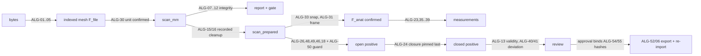

# CAD and Computational Geometry Engine Design v1.0

| Field | Value |
|---|---|
| Document | CAD_GEOMETRY_ENGINE_DESIGN_v1.0.md |
| Version / date | v1.0 · 2026-11-15 |
| Status | Draft v1.0 for review — engineering proposal. **Not approved**; no decision in this set is final until signed by the engineering lead (ADR/TD status "Proposed"). |
| Rule | Geometric operations never decide medical purpose: every magnitude, region, base and frame rule is a technician/clinic input (SAF-02, DEC-029). Algorithms below describe how geometry is computed, not which correction to apply. |

## 1. Kernel architecture

| Package | Responsibility | Algorithms |
|---|---|---|
| K01 io | Detection, parsing, indexed mesh, STL writer, re-read | ALG-01…06 |
| K02 validate | Topology, degenerates, components, orientation, self-intersection, watertightness, solid validity | ALG-07…13 |
| K03 frames | Units, anatomical frame, transform algebra, export frame | ALG-30…32, ALG-52 |
| K04 anchors | Closest point, anchors, coverage, region primitives | ALG-33, ALG-34, ALG-43 |
| K05 measure | Section, contour selection, CI, CVA/CVAI, HC, synthetic flag | ALG-23, ALG-35…39 |
| K06 ops | Cleanup, hole fill, decimation, normals, closure, offset, global adjustments, zones, overlap, smoothing, guard | ALG-14…18, ALG-24…26, ALG-46…50 |
| K07 compare | Signed distance, statistics | ALG-40, ALG-41 |
| K08 replay | Op-log replay, cache, hashes | ALG-53…55 |
| K09 export | Manifest build/validation | ALG-52 |
| shared | Exact predicates (orient2d/orient3d), BVH | TD-04, ALG-11, ALG-33 |

### 1.1 Kernel invariants

- Pure functions: arrays + explicit parameters in, arrays + report out; no I/O, clock, randomness or global state (07 §4.3).
- float64 coordinates in mm; int32 face indices; −0.0 canonicalised; face order deterministic (TD-21).
- Single-threaded numerics; fixed summation order; numba (if adopted) with fastmath off (TD-19).
- Design ops after closure regeneration are topology-preserving, so (face_id, bary) anchors stay valid (TD-07, assumes OQ-FS-01 = b).
- No silent repair: every topology change is a recorded, replayable op (ALG-22).
- Every op reports `rejected` with a reason instead of producing invalid geometry (ALG-50, SAF-09).

### 1.2 Coordinate systems

| Frame | Definition | Created by |
|---|---|---|
| F_file | File coordinates, unknown unit | ALG-02…05 |
| F_scan | F_file × s (mm) | ALG-30 |
| F_anat | Right-handed frame from clinic landmark rules; det +1 | ALG-31 |
| F_export | Configured rule on F_anat (DEC-015) | ALG-32/52 |
| Display | jude-mesh/1 in mm, F_anat when available, display_only | ALG-56 |

### 1.3 Pipeline (canonical steps 09:S2–S11, 08 §1)

## 2. Brief topic coverage

| Area | Topic | Algorithms | Release |
|---|---|---|---|
| Mesh processing | mesh import | ALG-01, ALG-02, ALG-03, ALG-04, ALG-05 | MVP |
| Mesh processing | mesh validation | ALG-05, ALG-07, ALG-08 | MVP |
| Mesh processing | mesh cleaning | ALG-15 | MVP |
| Mesh processing | mesh denoising | ALG-19 | research-only |
| Mesh processing | mesh smoothing | ALG-18 | MVP (Should) |
| Mesh processing | mesh decimation | ALG-17 | MVP (recorded op Should; LOD Must) |
| Mesh processing | remeshing | ALG-20 | research-only |
| Mesh processing | normal estimation | ALG-14 | MVP |
| Mesh processing | normal correction | ALG-10 | MVP |
| Mesh processing | connected components | ALG-09 | MVP |
| Mesh processing | boundary detection | ALG-07 | MVP |
| Mesh processing | hole detection | ALG-07 | MVP |
| Mesh processing | hole filling | ALG-16 | MVP (Should) |
| Mesh processing | surface reconstruction | ALG-21 | research-only |
| Mesh processing | mesh repair | ALG-15, ALG-22 | MVP |
| Solid geometry | open mesh to closed mesh conversion | ALG-24, ALG-25 | MVP |
| Solid geometry | watertightness | ALG-12, ALG-13 | MVP |
| Solid geometry | manifold validation | ALG-07, ALG-13 | MVP |
| Solid geometry | self-intersection detection | ALG-11 | MVP |
| Solid geometry | solid reconstruction | ALG-21 | research-only |
| Solid geometry | surface offset | ALG-26 | MVP (Should) |
| Solid geometry | shell generation | ALG-27 | post-MVP |
| Solid geometry | Boolean union | ALG-28 | Reserve (not required in MVP) |
| Solid geometry | Boolean difference | ALG-28 | Reserve (not required in MVP) |
| Solid geometry | Boolean intersection | ALG-28 | Reserve (not required in MVP) |
| Solid geometry | thickness analysis | ALG-29 | post-MVP |
| Cranial geometry | coordinate systems | ALG-30, ALG-31, ALG-32 | MVP |
| Cranial geometry | anatomical landmarks | ALG-31, ALG-33 | MVP |
| Cranial geometry | cranial measurements | ALG-23, ALG-35, ALG-36, ALG-37, ALG-38, ALG-39 | MVP; MVP (Should) |
| Cranial geometry | cranial surface analysis | ALG-34, ALG-40, ALG-45 | MVP; MVP (Should); post-MVP |
| Cranial geometry | symmetry analysis | ALG-37, ALG-42 | MVP; post-MVP |
| Cranial geometry | geometric comparison | ALG-33, ALG-40, ALG-41, ALG-44 | MVP; post-MVP |
| Cranial geometry | region segmentation | ALG-43 | MVP (manual regions); post-MVP (automatic) |
| Cranial geometry | surface deviation maps | ALG-40, ALG-57 | MVP |
| Helmet geometry | head surface input | ALG-01, ALG-05, ALG-30, ALG-22 | MVP |
| Helmet geometry | helmet shell generation | ALG-27 | post-MVP |
| Helmet geometry | inner and outer surfaces | ALG-27 | post-MVP |
| Helmet geometry | correction zones | ALG-46, ALG-47 | MVP |
| Helmet geometry | relief zones | ALG-46 | MVP |
| Helmet geometry | wall thickness | ALG-27, ALG-29 | post-MVP |
| Helmet geometry | edge treatment | ALG-51 | post-MVP |
| Helmet geometry | geometric constraints | ALG-47, ALG-48, ALG-49, ALG-50 | MVP |
| Helmet geometry | manufacturing geometry | ALG-52, ALG-06 | MVP |

Every topic of the brief maps to at least one algorithm. Topics without an approved requirement (denoising, remeshing, reconstruction, shell, wall thickness, symmetry overlay, edge treatment) are designed at outline level and are **not** in MVP (GAP-M05/M06/M07, FR-162 Won't, OQ-FS-33).

## 3. Mesh processing

### ALG-01 — File format detection by signature

*Topic: mesh import · functions: FN-KIO-01; FN-SCN-02.2 · release: MVP · status: Proposed*

| Aspect | Design |
|---|---|
| 1. Mathematical principle | Content sniffing: PLY magic "ply\n" + format line; binary STL iff 84 + 50*n == file size where n = uint32 at offset 80; ASCII STL iff first non-blank token "solid" AND a "facet" token within the first 4 KiB AND the size rule fails; OBJ iff lines begin with v/vn/vt/f/o/g/#. Extension is ignored (FR-010). |
| 2. Operation sequence | 1 read first 4 KiB and file size; 2 apply PLY rule; 3 apply binary-STL size rule (before ASCII rule: binary files may start with "solid"); 4 apply ASCII-STL rule; 5 apply OBJ grammar sniff; 6 otherwise FILE_UNREADABLE (unknown format). |
| 3. Inputs → outputs | bytes (bounded by cap S) → format enum {stl_bin, stl_ascii, obj, ply_ascii, ply_bin_le, ply_bin_be} + notices |
| 4. Complexity | O(1) on the 4 KiB prefix |
| 5. Numerical limits | None (byte rules). |
| 6. Known errors and edge cases | Binary STL whose 80-byte header starts with "solid"; truncated binary STL (size rule fails); UTF-8 BOM; CRLF line ends; empty file; ZIP/other binary renamed .stl. |
| 7. Libraries | Own (Python stdlib). Oracle: trimesh loader dispatch (LIB-TRIMESH). |
| 8. Alternatives | Trust extension (rejected: FR-010); libmagic (adds C dependency, no mesh rules). |
| 9. Testing | Unit: One fixture per format incl. binary STL with "solid" header; empty and random-bytes files. · Synthetic: T4 format set (same object in 6 encodings). · Edge: Truncated binary STL; BOM; header-only file. · Regression: Format fixtures frozen with expected enum. · Numerical: N/A — exact/combinatorial logic (no floating-point decision) · Invariants: Detection independent of file name. · Performance: None needed (constant time). |
| Sources / open items | 05 §1.1 [P]; G-SRC-10 [P] · OQ-FS-31 |

### ALG-02 — STL parsing (binary and ASCII)

*Topic: mesh import · functions: FN-KIO-02 · release: MVP · status: Proposed*

| Aspect | Design |
|---|---|
| 1. Mathematical principle | Binary: 80-byte header, uint32 n, n records of 12 float32 + uint16 attribute (little-endian), parsed with a numpy structured dtype; ASCII: streaming tokenizer over "facet normal / outer loop / vertex x y z / endloop / endfacet". Stored normals are ignored (recomputed from winding). |
| 2. Operation sequence | 1 validate n against size and face cap N_max (SEC-07) before allocation; 2 np.frombuffer with dtype [("n","<f4",3),("v","<f4",(3,3)),("a","<u2")]; 3 upcast to float64; 4 reject non-finite coordinates; 5 ASCII: tokenise line by line with a hard token/line limit, accumulate vertex triples, reject facets with != 3 vertices; 6 emit triangle soup (3n×3 float64). |
| 3. Inputs → outputs | bytes → triangle soup float64[3n,3] + import notices |
| 4. Complexity | Binary O(n) vectorised; ASCII O(bytes) tokenizer-bound [H] |
| 5. Numerical limits | float32 → float64 is exact; ASCII decimal → float64 rounding ≤ 0.5 ulp (Python float()). |
| 6. Known errors and edge cases | n = 0 (FILE_EMPTY); n × 50 + 84 ≠ size (truncated → FILE_UNREADABLE); NaN/Inf coordinates; ASCII with missing endloop; scientific notation; locale commas (reject); >N_max facets (face bomb). |
| 7. Libraries | Own (numpy). Oracle: trimesh (process=False), numpy-stl (BSD-3) as second oracle. |
| 8. Alternatives | trimesh.load (merges vertices by default, must pass process=False [N]); numpy-stl (BSD-3). |
| 9. Testing | Unit: Hand-built 1- and 2-facet files; header with "solid"; attribute bytes non-zero. · Synthetic: Icosphere written by FN-KIO-06 then re-read. · Edge: Truncated, NaN, face bomb (n = 2^31 claimed), 0 facets. · Regression: Byte fixtures with expected soup hash. · Numerical: Round-trip float32→float64→float32 identity. · Invariants: Facet count = n; soup order = file order. · Performance: BM-01 parse time vs n (binary and ASCII). |
| Sources / open items | 05 §1.1 [P] · OQ-FS-29 (N_max, S) |

### ALG-03 — OBJ parsing with polygon triangulation

*Topic: mesh import · functions: FN-KIO-03 · release: MVP · status: Proposed*

| Aspect | Design |
|---|---|
| 1. Mathematical principle | Line grammar: "v x y z [w]" and "f a[/t][/n] …" with 1-based and negative (relative) indices; vt/vn/mtllib/usemtl/o/g ignored with notice. Polygons with k > 3 vertices are triangulated in their best-fit plane (Newell normal) by ear clipping (ALG-25) — fan triangulation only when the polygon is convex in that plane. |
| 2. Operation sequence | 1 stream lines with per-line length cap; 2 collect vertices (float64); 3 resolve indices (negative → len+idx); 4 reject out-of-range; 5 for k = 3 emit; k = 4..K_max triangulate (Newell normal, project, convexity test with exact orient2d, fan if convex else ear clipping); 6 notices: textures ignored, n polygons triangulated, n non-planar polygons (max distance to plane). |
| 3. Inputs → outputs | bytes → indexed vertices float64[nv,3] + faces int32[m,3] + notices |
| 4. Complexity | O(bytes) + Σ O(k²) for ear clipping of k-gons |
| 5. Numerical limits | Planarity reported, not repaired; projection loses nothing for planar quads. |
| 6. Known errors and edge cases | Negative indices; faces before vertices; "f" with 2 vertices; non-planar or self-overlapping quads; w component; line continuation "\"; >K_max-gon. |
| 7. Libraries | Own. Oracle: trimesh (process=False). |
| 8. Alternatives | Fan triangulation only (wrong on concave polygons); trimesh loader (behaviour on concave polygons to verify [H]). |
| 9. Testing | Unit: Quads (convex/concave), negative indices, texture coords ignored with notice. · Synthetic: T4 OBJ with quads and negative indices vs STL of same object. · Edge: Degenerate polygon, out-of-range index, empty face line. · Regression: Fixture hashes. · Numerical: Triangulated area = polygon area (exact for planar). · Invariants: Triangulated faces keep polygon orientation. · Performance: BM-01 parse time. |
| Sources / open items | 05 §1.1 [P]; F-SRC-17 earcut [N] · TQ-18 |

### ALG-04 — PLY parsing (ASCII, binary LE/BE)

*Topic: mesh import · functions: FN-KIO-04 · release: MVP · status: Proposed*

| Aspect | Design |
|---|---|
| 1. Mathematical principle | Header grammar (element/property/list); body parsed per declared element; vertex x,y,z (float/double), face list (uchar/int count + int indices); other properties skipped by declared size. Binary bodies via numpy dtypes with declared endianness. |
| 2. Operation sequence | 1 parse header with line and element-count caps; 2 compute fixed record size for non-list elements; 3 vertex block via np.frombuffer; 4 face block: variable-length lists parsed with a bounded loop or, when all counts equal 3, a vectorised view; 5 polygons k > 3 → ALG-03 step 5; 6 notices for colour/normal/other properties. |
| 3. Inputs → outputs | bytes → indexed mesh + notices |
| 4. Complexity | O(bytes) |
| 5. Numerical limits | float32 vertices upcast exactly; double kept. |
| 6. Known errors and edge cases | Big-endian; list count type uint8 vs int32; extra elements (edges, materials); comments; obj_info; count mismatch vs body length; point clouds without faces (FILE_EMPTY for faces). |
| 7. Libraries | Own. NOT plyfile (GPL-3.0-or-later per PyPI metadata, LIB-PLYFILE) — excluded by ADR-011. Oracle: trimesh. |
| 8. Alternatives | plyfile (GPL, rejected); trimesh PLY loader (MIT) as production fallback [H]. |
| 9. Testing | Unit: ASCII, binary LE, binary BE fixtures; extra properties. · Synthetic: T4 PLY vs STL of same object. · Edge: Count mismatch, truncated body, huge declared count. · Regression: Fixture hashes. · Numerical: Exactness of double vertices. · Invariants: Same V/F as STL import of the same object after ALG-05. · Performance: BM-01. |
| Sources / open items | 05 §1.1 [P] · OQ-FS-31 |

### ALG-05 — Indexed mesh construction with exact vertex merge

*Topic: mesh import / mesh validation · functions: FN-KIO-05 · release: MVP · status: Proposed*

| Aspect | Design |
|---|---|
| 1. Mathematical principle | Bitwise-exact vertex welding: identical float64 triples (after canonicalising −0.0 to +0.0) map to one index; no epsilon welding (05 §1.1, avoids silently changing topology). Implementation: np.unique on a void/structured view of the (n,3) array with return_inverse; first-occurrence order kept by sorting unique indices by first appearance so output order is deterministic. |
| 2. Operation sequence | 1 canonicalise −0.0; 2 unique rows with first-occurrence ordering; 3 faces = inverse.reshape(-1,3); 4 drop nothing (degenerate faces are reported by ALG-08, not removed); 5 validate indices and finiteness; 6 build report (input soup size, unique vertices, merged count). |
| 3. Inputs → outputs | triangle soup float64[3m,3] or indexed arrays → DS-01 MeshArrays (V float64, F int32, face order = file order) |
| 4. Complexity | O(n log n) sort |
| 5. Numerical limits | Exact equality only; near-duplicates (e.g. 1e-12 apart) stay separate and appear as boundary/non-manifold metrics. |
| 6. Known errors and edge cases | Near-duplicate vertices from exporters; NaN (rejected earlier); > 2^31−1 vertices (rejected by cap). |
| 7. Libraries | numpy (BSD-3). |
| 8. Alternatives | Epsilon welding (rejected: changes topology silently); trimesh merge_vertices (tolerance-based [N]). |
| 9. Testing | Unit: Shared-vertex soup → expected V/F; −0.0 vs 0.0 merge. · Synthetic: Icosphere soup → Euler characteristic 2. · Edge: Near-duplicates stay separate. · Regression: Order fixture: shuffled soup gives identical V order rule. · Numerical: Bit equality of retained vertices. · Invariants: len(V) ≤ 3m; F indices < len(V); geometry of every face unchanged bitwise. · Performance: BM-01 at 10^4…10^6 faces. |
| Sources / open items | 05 §1.1 [P] · — |

### ALG-06 — Binary STL writer and independent re-read comparison

*Topic: manufacturing geometry · functions: FN-KIO-06; FN-KIO-07; FN-EXP-02.2; FN-EXP-02.4 · release: MVP · status: Proposed*

| Aspect | Design |
|---|---|
| 1. Mathematical principle | Write: float64 → float32 rounding (round-to-nearest), facet normal = normalised (b−a)×(c−a) in float64 then cast, attribute 0, little-endian, 80-byte ASCII header with schema id and design id (no patient data). Re-read: parse with an implementation independent of the writer (FN-KIO-02 own parser vs oracle second reader) and compare per vertex in face order: max \|v_file − v_approved\| ≤ file-fidelity tolerance 1e-4 mm (DEC-025). |
| 2. Operation sequence | 1 transform to F_export (ALG-52); 2 cast; 3 write; 4 SHA-256 of bytes; 5 re-read; 6 compare counts and max deviation; 7 release only on pass. |
| 3. Inputs → outputs | DS-01 positive in F_export → STL bytes, sha256, ReimportResult {passed, max_dev_mm, n_tri} |
| 4. Complexity | O(m) |
| 5. Numerical limits | float32 spacing at 200 mm ≈ 1.5e-5 mm (2^-23 × 128 mm) → rounding ≤ 7.6e-6 mm < 1e-4 mm [N, derived]. |
| 6. Known errors and edge cases | Coordinates far from origin increase float32 rounding (export frame keeps the head near the origin); degenerate faces give zero normals (written as 0,0,0). |
| 7. Libraries | Own (numpy). Second reader: numpy-stl (BSD-3) or trimesh (MIT) — whichever is not the production parser. |
| 8. Alternatives | ASCII STL (larger, decimal rounding); 3MF (post-MVP, FN-PMV-11). |
| 9. Testing | Unit: Known triangle → known bytes; header content check. · Synthetic: T10 export round-trip with corruption injection. · Edge: Large coordinates (1e4 mm) reported deviation. · Regression: Byte-identical output for reference designs. · Numerical: Max rounding error vs analytic float32 bound. · Invariants: Triangle count preserved; orientation preserved; laterality preserved (VER-03). · Performance: BM-07 export time. |
| Sources / open items | 05 §5 [P]; 08 §5 [P] · — |

### ALG-07 — Edge topology, boundary loops and non-manifold detection

*Topic: mesh validation / boundary detection / hole detection / manifold validation · functions: FN-KVL-01 · release: MVP · status: Proposed*

| Aspect | Design |
|---|---|
| 1. Mathematical principle | Undirected edge key k = (min(a,b), max(a,b)) per face edge; incidence count c(k) by sort + run-length. c = 1 → boundary edge, c = 2 → interior, c > 2 → non-manifold edge. Boundary loops: directed boundary half-edges form a functional graph; trace cycles starting from the smallest vertex id. Non-manifold vertex: the faces around a vertex form more than one edge-connected fan (count fans with union-find over faces sharing an edge incident to the vertex). Loop perimeter = Σ edge lengths. |
| 2. Operation sequence | 1 build 3m directed half-edges; 2 undirected keys, lexsort, counts; 3 classify; 4 boundary half-edges map start→end; vertices with several outgoing boundary edges are non-manifold boundary vertices — loops split at them deterministically (smallest next id); 5 per-vertex fan count; 6 report counts, loops (vertex lists, perimeter, bbox), non-manifold elements (≤ 100 samples). |
| 3. Inputs → outputs | DS-01 → TopologyReport {n_boundary_edges, loops[], n_nonmanifold_edges, n_nonmanifold_vertices, euler_char} |
| 4. Complexity | O(m log m) |
| 5. Numerical limits | Combinatorial (exact); perimeters inherit float64 rounding only. |
| 6. Known errors and edge cases | Bow-tie vertices; boundary loops touching at a vertex; isolated vertices (reported, not removed); duplicate faces (c = 2 with same orientation → flagged by ALG-10). |
| 7. Libraries | Own (numpy, scipy.sparse). Oracle: trimesh graph utilities, CGAL PMP (oracle job). |
| 8. Alternatives | Half-edge data structure (OpenMesh BSD, LIB-OPENMESH) — cannot represent non-manifold input, so metrics must be computed before it. |
| 9. Testing | Unit: Single triangle (3 boundary edges, 1 loop); two triangles sharing an edge; three faces on one edge (non-manifold). · Synthetic: T3 holes of set perimeter; icosphere (0 boundary, χ = 2). · Edge: Bow-tie; touching loops. · Regression: VER-08 defect catalogue counts. · Numerical: Perimeter of a circular hole of radius r vs 2πr minus chord error. · Invariants: Σ c(k) = 3m; χ = V − E + F; loops partition boundary edges. · Performance: BM-01 at 10^4…10^6 faces. |
| Sources / open items | F-SRC-10 [N]; 05 §1.2 [P] · — |

### ALG-08 — Degenerate face detection

*Topic: mesh validation · functions: FN-KVL-02 · release: MVP · status: Proposed*

| Aspect | Design |
|---|---|
| 1. Mathematical principle | Face area A = ½‖(b−a)×(c−a)‖ (float64). Degenerate iff A ≤ ε_area OR exact collinearity (orient-type test on the three points in their best plane) OR repeated vertex index. Needle/cap faces reported separately by min angle (diagnostic only). |
| 2. Operation sequence | 1 vectorised cross products; 2 index-repeat check; 3 compare with ε_area (constant from VER-01 numerical analysis, OQ-FS-13); 4 report count + samples. |
| 3. Inputs → outputs | DS-01 → {n_degenerate, n_repeated_index, samples} |
| 4. Complexity | O(m) |
| 5. Numerical limits | Area of a 0.1 mm triangle ≈ 4e-3 mm²; float64 noise on coordinates ~200 mm ≈ 3e-14 mm → noise in A ≈ 1e-14 mm² [N, derived]; ε_area TBD (OQ-FS-13). |
| 6. Known errors and edge cases | Sliver faces that are not exactly zero area; faces with repeated vertex after exact merge. |
| 7. Libraries | numpy. |
| 8. Alternatives | Relative ε (fraction of median face area) — proposed alternative in OQ-FS-13. |
| 9. Testing | Unit: Zero-area, collinear, repeated-index, valid faces. · Synthetic: T3 seeded degenerate faces. · Edge: Area just above/below ε. · Regression: Counts. · Numerical: Scale invariance check: scaling by s scales A by s². · Invariants: Count independent of face order. · Performance: Negligible. |
| Sources / open items | FR-013 [P] · OQ-FS-13 |

### ALG-09 — Connected components

*Topic: connected components · functions: FN-KVL-03; FN-KOP-01 · release: MVP · status: Proposed*

| Aspect | Design |
|---|---|
| 1. Mathematical principle | Graph on faces with an edge for each shared undirected edge (manifold or not) → scipy.sparse.csgraph.connected_components; components ordered by (−face count, min face id) for deterministic labels. |
| 2. Operation sequence | 1 face adjacency from ALG-07 edge keys; 2 connected_components (BFS, deterministic); 3 relabel by size order; 4 per component: faces, area, bbox, boundary loops. |
| 3. Inputs → outputs | DS-01 + ALG-07 edge table → {n_components, components[{label, n_faces, area_mm2, bbox}]}, face→label array |
| 4. Complexity | O(m) |
| 5. Numerical limits | Combinatorial. |
| 6. Known errors and edge cases | Components connected only through a vertex (counted separate under edge-connectivity — documented rule); isolated vertices. |
| 7. Libraries | scipy (BSD-3). |
| 8. Alternatives | Vertex-connectivity (merges bow-ties); union-find own. |
| 9. Testing | Unit: Two disjoint spheres → 2; bow-tie → 2 (edge rule). · Synthetic: T3 extra component. · Edge: Single face component. · Regression: Counts. · Numerical: N/A — exact/combinatorial logic (no floating-point decision) · Invariants: Σ faces = m; labels independent of input face permutation up to the documented order rule. · Performance: BM-01. |
| Sources / open items | 05 §1.2 [P] · — |

### ALG-10 — Orientation consistency, outward test and recorded re-orientation

*Topic: normal correction · functions: FN-KVL-04; FN-KOP-06.5 · release: MVP · status: Proposed (scan re-orientation op pending OQ-FS-37)*

| Aspect | Design |
|---|---|
| 1. Mathematical principle | Consistency: for every manifold interior edge the two incident faces must traverse it in opposite directions (directed half-edge appears once in each direction). Outward test: closed component → signed volume V = (1/6) Σ a·(b×c) > 0; open scan → hint only: mean of n_f·(c_f − centroid) weighted by area > 0, flagged as heuristic. Re-orientation: BFS over faces from the largest-area face, flipping neighbours with inconsistent winding; ambiguous (non-orientable) components reported. |
| 2. Operation sequence | 1 count inconsistent interior edges; 2 per component signed volume (closed) or heuristic hint (open); 3 optional recorded op normalise_orientation (only if OQ-FS-37 = a) — never silent; 4 closure faces created by ALG-24 are oriented by construction. |
| 3. Inputs → outputs | DS-01 → {n_inconsistent_edges, per_component: {closed, signed_volume_mm3 \| outward_hint}} |
| 4. Complexity | O(m) |
| 5. Numerical limits | Signed volume summed in face order (determinism); translation-invariant formula uses centroid shift to reduce cancellation. |
| 6. Known errors and edge cases | Möbius-like scans (non-orientable); inward-wound scans; components with holes (no volume). |
| 7. Libraries | Own (numpy, scipy.sparse). Oracle: trimesh.repair.fix_winding (comparison only). |
| 8. Alternatives | trimesh fix_normals (applies changes; not allowed silently); ray-parity outward test (fails on open meshes). |
| 9. Testing | Unit: Sphere with one flipped face → 3 inconsistent edges; inverted sphere → negative volume. · Synthetic: T3 flipped faces; T6 sign sphere. · Edge: Non-orientable strip. · Regression: Counts. · Numerical: Volume of icosphere vs (4/3)πr³ minus discretisation (DEC-025 table). · Invariants: Flipping all faces negates volume; translation leaves volume unchanged. · Performance: BM-01. |
| Sources / open items | 05 §1.5 [P]; RG-03 [P] · OQ-FS-37 |

### ALG-14 — Vertex normal estimation (angle-weighted)

*Topic: normal estimation · functions: FN-KOP-05 · release: MVP · status: Proposed (weighting = OQ-FS-11)*

| Aspect | Design |
|---|---|
| 1. Mathematical principle | n_v = normalise(Σ_f α_{f,v} n_f) with α the interior angle of face f at v (Thürmer–Wüthrich); face normal from winding. Summation in face order for determinism. Zero-length result (cancellation) → fallback to area-weighted, flagged. |
| 2. Operation sequence | 1 face normals (unnormalised cross, then normalised); 2 corner angles via atan2(‖u×w‖, u·w) (stable); 3 scatter-add with np.add.at in face order; 4 normalise; 5 flag degenerate vertices. |
| 3. Inputs → outputs | DS-01 → float64[n,3] unit normals + flags |
| 4. Complexity | O(m) |
| 5. Numerical limits | atan2 form avoids acos domain errors; np.add.at deterministic but slower than bincount [N]. |
| 6. Known errors and edge cases | Vertices on sharp creases (wall/cap edges of the positive); isolated vertices; degenerate faces (zero weight). |
| 7. Libraries | numpy. |
| 8. Alternatives | Area-weighted (default in many libraries); uniform; PCA normals for point clouds (Open3D) — not needed for meshes. |
| 9. Testing | Unit: Cube corner normal = (1,1,1)/√3; sphere vertex normal vs radial direction. · Synthetic: Icosphere angle error vs radial. · Edge: Crease vertices. · Regression: Normal array hash. · Numerical: Invariance to uniform scaling and to face subdivision on planar regions. · Invariants: Normals flip when all faces flip. · Performance: Negligible. |
| Sources / open items | F-SRC-05 [N]; 05 §1.5 [P] · OQ-FS-11 |

### ALG-15 — Recorded face removal and compaction (mesh cleaning)

*Topic: mesh cleaning / mesh repair · functions: FN-KOP-01; FN-SCN-11.1; FN-SCN-11.2 · release: MVP · status: Proposed*

| Aspect | Design |
|---|---|
| 1. Mathematical principle | Remove a set of face ids (from UI selection or component labels) and compact vertices keeping relative order; record (op type, op_version, face_ids on input mesh) so replay is exact (FR-020, FR-023). |
| 2. Operation sequence | 1 validate ids ⊂ [0,m); 2 keep-mask; 3 new F = F[keep]; 4 used vertices in original order → remap; 5 report removed faces/vertices, new boundary loops. |
| 3. Inputs → outputs | DS-01 + face_ids int32[] → DS-01 + map old→new vertex ids (for anchors) |
| 4. Complexity | O(m + n) |
| 5. Numerical limits | Exact (no coordinates change). |
| 6. Known errors and edge cases | Removing all faces (rejected); removal creating non-manifold vertices (reported by ALG-07). |
| 7. Libraries | numpy. |
| 8. Alternatives | Region growing by curvature (post-MVP segmentation, ALG-43). |
| 9. Testing | Unit: Remove one face; remove a component. · Synthetic: Sphere + extra component → remove component → 1 component. · Edge: Empty selection; all faces. · Regression: Disable all cleanup ops reproduces original hash (TC-FR-023). · Numerical: N/A — exact/combinatorial logic (no floating-point decision) · Invariants: Remaining face coordinates bit-identical. · Performance: Negligible. |
| Sources / open items | FR-020 [P] · — |

### ALG-16 — Hole filling: minimum-weight triangulation + refinement (+ optional fairing)

*Topic: hole filling · functions: FN-KOP-02 · release: MVP (Should) · status: Proposed (scope OQ-FS-16/OQ-FS-28)*

| Aspect | Design |
|---|---|
| 1. Mathematical principle | Liepa (2003): (1) triangulate the boundary polygon by dynamic programming minimising (max dihedral angle, then area) — O(n³); (2) refine patch so triangle sizes match the boundary edge density (σ-density criterion, Delaunay-like edge swaps); (3) optional fairing by solving a discrete (bi)Laplacian with boundary rings fixed (sparse SPD solve). New faces tagged synthetic. |
| 2. Operation sequence | 1 take technician-selected loop ids (OQ-FS-16) with perimeter ≤ P; 2 reject loops with > n_max vertices (bounds O(n³); constant TQ-12); 3 DP triangulation with deterministic tie-break (lexicographic on vertex ids); 4 refinement; 5 fairing if flag; 6 orientation consistent with surrounding faces; 7 post-op guard ALG-50. |
| 3. Inputs → outputs | DS-01 + loop ids + max_perimeter_mm + fairing flag → DS-01 with face_tags synthetic=1 + report |
| 4. Complexity | O(n³) per loop (DP) + sparse solve O(p^1.5) typical for p patch vertices [N] |
| 5. Numerical limits | Fairing solve: conjugate gradient with fixed tolerance & iteration cap (deterministic single-thread) or direct sparse LU (scipy SuperLU) [H]. |
| 6. Known errors and edge cases | Non-planar saddle holes; loops touching other loops; islands inside holes; loops on a non-oriented neighbourhood (precondition fails). |
| 7. Libraries | Own (numpy, scipy.sparse). Oracle: CGAL triangulate_refine_and_fair_hole (CI). Fallback for tiny loops: VTK vtkFillHolesFilter (BSD) [N]. |
| 8. Alternatives | trimesh fill_holes (trivial holes only [N]); alpha wrap (moves whole surface, rejected); screened Poisson (replaces surface). |
| 9. Testing | Unit: Planar circular hole → patch planar; triangle count ~ boundary density. · Synthetic: T3 holes of set perimeter on sphere (fill restores closedness; patch deviation from sphere reported). · Edge: Loop of 3 vertices; loop above n_max → rejected; saddle hole. · Regression: Patch hash for fixtures. · Numerical: Fairing convergence and determinism (100 runs). · Invariants: Faces outside patch bit-identical; boundary vertices fixed; result loop count decreases by number of filled loops. · Performance: Time vs loop size n (n³ growth). |
| Sources / open items | G-SRC-05, G-SRC-06 [P] · OQ-FS-16; OQ-FS-28; TQ-12 |

### ALG-17 — Quadric error metric decimation with topology constraints

*Topic: mesh decimation · functions: FN-KOP-03; FN-KOP-04 · release: MVP (recorded op Should; LOD Must) · status: Candidate (library vs own: X-01)*

| Aspect | Design |
|---|---|
| 1. Mathematical principle | Garland–Heckbert: each vertex accumulates Q = Σ p pᵀ over incident face planes; edge collapse cost = v̄ᵀ(Q₁+Q₂)v̄ at the optimal or endpoint position; greedy by priority queue. Constraints: link condition (prevents non-manifold), boundary-edge lock (or boundary quadrics), normal-flip rejection, minimum triangle quality. Deterministic tie-break: (cost, min vertex id). |
| 2. Operation sequence | 1 quadrics; 2 heap of candidate edges; 3 collapse while faces > target and constraints hold; 4 compact; 5 report one-sided Hausdorff (ALG-41) between output vertices and input surface; 6 LOD output flagged display_only (INV-10). |
| 3. Inputs → outputs | DS-01 + target_faces → DS-01 + report {achieved_faces, max_dev_mm, rms_dev_mm} |
| 4. Complexity | O(m log m) |
| 5. Numerical limits | Optimal position solve 3×3 may be singular → fall back to endpoint/midpoint. |
| 6. Known errors and edge cases | Thin features collapse; boundaries; already-coarse meshes; non-manifold input (refused). |
| 7. Libraries | Candidates: VTK vtkQuadricDecimation (BSD-3), fast-simplification (MIT), Open3D simplify_quadric_decimation (MIT), meshoptimizer (MIT, LOD only); own implementation as fallback. |
| 8. Alternatives | Vertex clustering (fast, poor quality); edge-length based; remeshing (ALG-20). |
| 9. Testing | Unit: Planar grid decimates to 2 triangles with zero error. · Synthetic: Icosphere s=7 → targets; Hausdorff vs analytic sphere. · Edge: Target ≥ input; boundary lock. · Regression: Determinism 100 runs (X-01). · Numerical: Singular quadric fallback. · Invariants: Output manifold if input manifold; Euler characteristic preserved (genus kept). · Performance: Time vs m; LOD build time. |
| Sources / open items | G-SRC-09 [P] · OQ-FS-17; TQ-07 |

### ALG-18 — Local windowed-sinc smoothing (Taubin/VTK style) with blended rim

*Topic: mesh smoothing · functions: FN-KOP-12 · release: MVP (Should) · status: Candidate (VTK vs own: TQ-06)*

| Aspect | Design |
|---|---|
| 1. Mathematical principle | Low-pass filter on the graph Laplacian approximated by a windowed Chebyshev expansion (windowed sinc, pass-band k_PB, N iterations) — negligible shrinkage compared with uniform Laplacian [P G-SRC-12]. Applied only to the technician region: submesh = vertices with w > 0, rim vertices fixed; final position v' = v + w(ρ)(v_s − v) with smoothstep w across the transition (OQ-FS-20). Outside region bit-identical. |
| 2. Operation sequence | 1 region from anchored centre + radius + transition (Euclidean, as zones); 2 extract submesh with one fixed ring; 3 filter (normalised coordinates, as VTK does); 4 blend by w; 5 guard ALG-50; 6 report max/RMS deviation (ALG-41); 7 measurements refuse smoothed artifacts (FR-179). |
| 3. Inputs → outputs | DS-01 + centre anchor + radius_mm + transition_mm + iterations + passband → DS-01 + deviation report |
| 4. Complexity | O(N · edges in region) |
| 5. Numerical limits | VTK normalises coordinates to a unit box before filtering [N]; own implementation must match for parameter equivalence. |
| 6. Known errors and edge cases | Region touching closure faces (excluded: smoothing only on scan-origin faces); region covering whole mesh; N = 0. |
| 7. Libraries | VTK vtkWindowedSincPolyDataFilter (BSD-3) candidate; own numpy/scipy.sparse implementation fallback. |
| 8. Alternatives | Taubin λ/μ (F-SRC-06); bilateral; Laplacian (rejected, shrinkage). |
| 9. Testing | Unit: Plane stays plane; sphere radius change below tolerance for given N. · Synthetic: Noisy sphere (seeded) → RMS noise reduced, mean radius kept. · Edge: Region outside mesh; N = 0 → identity. · Regression: Determinism (X-01). · Numerical: Pass-band edge cases (0.001…0.1). · Invariants: Vertices outside region+transition bit-identical (FR-179 AC). · Performance: Time vs region size. |
| Sources / open items | G-SRC-12 [P]; F-SRC-06 [N] · OQ-FS-20; TQ-06 |

### ALG-19 — Mesh denoising (feature-preserving)

*Topic: mesh denoising · functions: FN-PMV-12 · release: research-only · status: Not in scope (no requirement, GAP-M05)*

| Aspect | Design |
|---|---|
| 1. Mathematical principle | Bilateral normal filtering (Zheng et al. 2011): filter face normals with spatial and range kernels, then update vertices to fit filtered normals. |
| 2. Operation sequence | Outline only: normal filtering iterations; vertex update iterations; report deviation. |
| 3. Inputs → outputs | Scan mesh → Denoised mesh |
| 4. Complexity | O(iterations · m · neighbourhood) |
| 5. Numerical limits | Parameter-sensitive (σ_s, σ_r). |
| 6. Known errors and edge cases | Changes measured surface and indices (RG-05). |
| 7. Libraries | Own or Open3D (MIT) filters; PyMeshLab (GPL, oracle only). |
| 8. Alternatives | Artec Studio processing before export (current baseline, ODC-04). |
| 9. Testing | Unit: Outline — to be designed when the topic enters scope · Synthetic: Outline — to be designed when the topic enters scope · Edge: Outline — to be designed when the topic enters scope · Regression: Outline — to be designed when the topic enters scope · Numerical: Outline — to be designed when the topic enters scope · Invariants: Outline — to be designed when the topic enters scope · Performance: Outline — to be designed when the topic enters scope |
| Sources / open items | F-SRC-14 [N] · OQ-FS-33 |

### ALG-20 — Isotropic remeshing

*Topic: remeshing · functions: FN-PMV-12 · release: research-only · status: Not in scope (GAP-M06)*

| Aspect | Design |
|---|---|
| 1. Mathematical principle | Botsch–Kobbelt: iterate split long edges (> 4/3 L), collapse short (< 4/5 L), flip to valence 6, tangential relaxation, project to input. |
| 2. Operation sequence | Outline only. |
| 3. Inputs → outputs | Mesh + target length → Remeshed mesh |
| 4. Complexity | O(iterations · m) |
| 5. Numerical limits | Projection to original surface needs BVH (ALG-33). |
| 6. Known errors and edge cases | Invalidates all (face_id, bary) anchors (FN-KAN-02). |
| 7. Libraries | CGAL isotropic_remeshing (GPL); PyMeshLab (GPL); own. |
| 8. Alternatives | Keep scan topology (MVP). |
| 9. Testing | Unit: Outline — to be designed when the topic enters scope · Synthetic: Outline — to be designed when the topic enters scope · Edge: Outline — to be designed when the topic enters scope · Regression: Outline — to be designed when the topic enters scope · Numerical: Outline — to be designed when the topic enters scope · Invariants: Outline — to be designed when the topic enters scope · Performance: Outline — to be designed when the topic enters scope |
| Sources / open items | G-SRC-04b [P] · OQ-FS-33 |

### ALG-22 — Mesh repair policy (explicit recorded repair only)

*Topic: mesh repair · functions: FN-SCN-11; FN-KOP-01; FN-KOP-02; FN-KVL-04 · release: MVP · status: Proposed*

| Aspect | Design |
|---|---|
| 1. Mathematical principle | No silent repair (05 §6.2). Repair = composition of recorded ops chosen by the technician: remove faces/components (ALG-15), fill selected holes (ALG-16), optional orientation normalisation (ALG-10, OQ-FS-37). Each op is versioned, replayable and visible in reports. |
| 2. Operation sequence | 1 integrity report (ALG-07…12); 2 technician selects ops; 3 replay cleanup chain; 4 new integrity report on scan_prepared. |
| 3. Inputs → outputs | Scan + cleanup op list → scan_prepared + integrity report |
| 4. Complexity | Sum of ops |
| 5. Numerical limits | — |
| 6. Known errors and edge cases | Topology change invalidates anchors placed before cleanup (anchors are placed on scan_prepared only). |
| 7. Libraries | Own. |
| 8. Alternatives | Automatic repair (pymeshfix — AGPL-3.0 per PyPI, rejected; MeshLab filters — GPL). |
| 9. Testing | Unit: Op list replay equality. · Synthetic: VER-08 fixtures repaired by recorded ops. · Edge: Empty op list → original. · Regression: TC-FR-023. · Numerical: N/A — exact/combinatorial logic (no floating-point decision) · Invariants: Disable all ops → original hash. · Performance: Not separately budgeted (linear, small inputs); covered by BM-07 end-to-end timing |
| Sources / open items | 05 §6.2 [P] · OQ-FS-37 |

## 4. Solid geometry

### ALG-11 — Self-intersection detection with exact predicates

*Topic: self-intersection detection · functions: FN-KVL-05; FN-KVL-05.1; FN-KVL-05.2; FN-KVL-05.3; FN-KVL-05.4; FN-KOP-13 · release: MVP · status: Proposed (feasibility = experiment X-02)*

| Aspect | Design |
|---|---|
| 1. Mathematical principle | Broad phase: AABB BVH (median split on centroid, deterministic) or sweep-and-prune over sorted boxes; candidate pairs i < j with overlapping boxes. Narrow phase: Guigue–Devillers triangle–triangle overlap built only from orient3d/orient2d signs; signs evaluated by a floating-point filter (static error bound) with exact fallback (Shewchuk adaptive arithmetic or rational arithmetic). Adjacent pairs: shared edge → intersect iff coplanar and overlapping on the same side (fold); shared vertex → test whether the opposite edge of each triangle crosses the other triangle. |
| 2. Operation sequence | 1 face AABBs (float64, inflated by 0 — exact boxes); 2 BVH build; 3 traverse self-pairs; 4 classify pair adjacency via vertex sets; 5 non-adjacent: GD test; 6 count + up to 100 sample pairs/points; 7 incremental mode: query only faces touching moved vertices against the full BVH (box refit, no rebuild); 8 time budget per call → SELF_INTERSECTION_TIMEOUT, never "0". |
| 3. Inputs → outputs | DS-01; optional face subset → {self_intersecting_pairs, samples[≤100]} |
| 4. Complexity | O(m log m + k) expected for BVH with k candidate pairs [N]; worst case O(m²) for pathological overlap (ghost layers produce many candidates) [H] |
| 5. Numerical limits | Float-only Möller test gives false results on near-coplanar layers [N F-SRC-01]; exact signs remove rounding errors entirely; filter success rate on scans is a hypothesis [H]. |
| 6. Known errors and edge cases | Coplanar overlapping triangles; triangles touching at a point; duplicate faces; ghost layers (two near-identical surfaces); degenerate faces (handled as segments/points). |
| 7. Libraries | Own (numpy + numba LIB-NUMBA candidate for inner loops) with own port of Shewchuk predicates (public domain, LIB-PREDICATES). Oracle: CGAL PMP does_self_intersect (GPL, CI only, LIB-CGAL). |
| 8. Alternatives | CGAL (GPL/commercial, OQ-G5); libigl copyleft/cgal (GPL); MeshLib (commercial licence, LIB-MESHLIB); Möller float test (rejected alone). |
| 9. Testing | Unit: Hand-built pairs: crossing, touching edge, touching vertex, coplanar overlap, coplanar disjoint, shared-edge fold, shared-vertex crossing. · Synthetic: T3 self-intersection and ghost-layer fixtures; T8 property-based random zones. · Edge: Triangles offset by 1 ulp; tiny/huge coordinates; duplicate faces. · Regression: Counts equal to CGAL oracle on VER-08 (FN-OPS-07). · Numerical: Perturbation test: translate/scale by powers of two (exact) → identical count. · Invariants: Count invariant under face permutation and exact rigid motions (permutations of axes). · Performance: X-02 / BM-01: time vs m for clean phantoms and ghost-layer fixtures; incremental mode time vs moved-vertex count. |
| Sources / open items | F-SRC-01, F-SRC-02, F-SRC-03 [N]; G-SRC-04 [P] · TQ-11; TQ-26 |

### ALG-12 — Watertightness, signed volume and bounding box

*Topic: watertightness · functions: FN-KVL-06 · release: MVP · status: Proposed*

| Aspect | Design |
|---|---|
| 1. Mathematical principle | Watertight iff no boundary edges and no non-manifold edges (ALG-07). Volume by divergence theorem V = (1/6) Σ (a−o)·((b−o)×(c−o)) with o = bbox centre (reduces cancellation). Axis-aligned bbox in the current frame. |
| 2. Operation sequence | 1 reuse ALG-07; 2 volume in face order; 3 bbox min/max; 4 report. |
| 3. Inputs → outputs | DS-01 → {watertight, volume_mm3, bbox_min, bbox_max} |
| 4. Complexity | O(m) |
| 5. Numerical limits | Relative error of V ~ m·ε_mach [N]; volume is meaningful only for closed meshes (flagged otherwise). |
| 6. Known errors and edge cases | Open meshes (volume = null, not a number); inverted orientation (negative volume reported). |
| 7. Libraries | numpy. |
| 8. Alternatives | trimesh.volume (same formula [N]). |
| 9. Testing | Unit: Unit cube = 1; tetrahedron analytic. · Synthetic: Icosphere vs DEC-025 discretisation table. · Edge: Open mesh → null. · Regression: Values. · Numerical: Translation by 10^4 mm changes V by < 1e-9 relative. · Invariants: Rigid motion invariance of V; bbox of union ⊇ parts. · Performance: Negligible. |
| Sources / open items | 05 §1.2 [P] · — |

### ALG-13 — Composite solid validity (validate.solid)

*Topic: watertightness / manifold validation / solid validity · functions: FN-KVL-07; FN-REV-01; FN-REV-03; FN-KOP-06.5 · release: MVP · status: Proposed*

| Aspect | Design |
|---|---|
| 1. Mathematical principle | Conjunction of geometric checks: boundary edges = 0; non-manifold edges = 0; non-manifold vertices = 0; self-intersections = 0 (ALG-11); components = 1; inconsistent edges = 0; signed volume > 0 (outward); degenerate faces = 0. Each check reported separately with label "geometric check" (FR-082). |
| 2. Operation sequence | 1 run ALG-07, -08, -09, -10, -11, -12; 2 evaluate checks in fixed order; 3 produce ValidityReport bound to geometry_sha. |
| 3. Inputs → outputs | DS-01 + geometry_sha → DS-25 ValidityReport |
| 4. Complexity | Dominated by ALG-11 |
| 5. Numerical limits | Exact for all combinatorial checks; volume sign exact via exact predicates when \|V\| is below a filter bound [H]. |
| 6. Known errors and edge cases | Valid but thin walls (not checked in MVP — positive is solid); multiple shells. |
| 7. Libraries | Own; oracle manifold3d status (Manifold accepts only valid manifolds, LIB-MANIFOLD) and CGAL. |
| 8. Alternatives | manifold3d constructor as validity oracle (reports error status for non-manifold input [N]). |
| 9. Testing | Unit: Each defect type fails exactly its check. · Synthetic: VER-08 + VER-15 fixtures. · Edge: Volume ≈ 0 slivers. · Regression: Report snapshots. · Numerical: N/A — exact/combinatorial logic (no floating-point decision) · Invariants: All checks pass on analytic closed phantoms. · Performance: BM-01. |
| Sources / open items | 08 §1 P10 [P]; FR-080 [P] · — |

### ALG-21 — Surface / solid reconstruction (screened Poisson, alpha wrapping)

*Topic: surface reconstruction / solid reconstruction · functions: FN-PMV-12 · release: research-only · status: Not in scope (GAP-M06)*

| Aspect | Design |
|---|---|
| 1. Mathematical principle | Screened Poisson: solve ∇²χ = ∇·V with screening to fit an indicator function, extract iso-surface. Alpha wrap: shrink-wrap an offset envelope guaranteed watertight and manifold. |
| 2. Operation sequence | Outline only. |
| 3. Inputs → outputs | Oriented points / mesh → Watertight mesh (new topology) |
| 4. Complexity | Octree depth-dependent |
| 5. Numerical limits | Moves or replaces the measured surface [P G-SRC-08]. |
| 6. Known errors and edge cases | Invents geometry in holes; changes indices. |
| 7. Libraries | Open3D Poisson (MIT); CGAL alpha wrap (GPL); PyMeshLab (GPL). |
| 8. Alternatives | Positive closure ALG-24 (MVP). |
| 9. Testing | Unit: Outline — to be designed when the topic enters scope · Synthetic: Outline — to be designed when the topic enters scope · Edge: Outline — to be designed when the topic enters scope · Regression: Outline — to be designed when the topic enters scope · Numerical: Outline — to be designed when the topic enters scope · Invariants: Outline — to be designed when the topic enters scope · Performance: Outline — to be designed when the topic enters scope |
| Sources / open items | F-SRC-12 [N]; G-SRC-07, G-SRC-08 [P] · OQ-FS-33 |

### ALG-23 — Plane section to contours with symbolic tie rule

*Topic: cranial measurements / closure · functions: FN-KMS-01; FN-KMS-01.1; FN-KMS-01.2; FN-KMS-01.3; FN-KOP-06.1; FN-KOP-09 · release: MVP · status: Proposed*

| Aspect | Design |
|---|---|
| 1. Mathematical principle | Signed distances d_i = n̂·(v_i − p). Symbolic perturbation: d = 0 is treated as positive, so no vertex lies on the plane and every crossed edge (sign change) yields exactly one point x = v_a + d_a/(d_a − d_b)(v_b − v_a). Each crossed face contributes one segment; segments chained through shared edges into closed contours or open polylines. |
| 2. Operation sequence | 1 d_i; 2 sign bits with tie rule; 3 crossed edges (unique edge keys); 4 interpolate points once per edge (shared by both faces → exact chaining); 5 face → segment; 6 chain via edge adjacency, start at smallest edge key, orientation counter-clockwise about n̂; 7 classify closed/open. |
| 3. Inputs → outputs | DS-01 + plane (point, unit normal) → DS-09 contours (closed/open, points float64[k,3], source edge keys) |
| 4. Complexity | O(m) |
| 5. Numerical limits | Interpolation divides by (d_a − d_b) which is non-zero by construction of the sign change; point accuracy limited by float64; chord error vs smooth surface is a mesh property (DEC-025 perimeter 0.032 mm on R = 75 mm s=6). |
| 6. Known errors and edge cases | Plane through vertices/edges (tie rule); tangent plane (no crossing); multiple contours (ears, artefacts); boundary edges → open polylines. |
| 7. Libraries | Own (numpy). Oracle: trimesh.intersections.mesh_plane / section (MIT). |
| 8. Alternatives | trimesh section (tie handling and order not specified for our contract [N]); VTK vtkCutter (BSD). |
| 9. Testing | Unit: Cube cut through vertices; tetrahedron cut through edge. · Synthetic: Sphere section circle: perimeter vs 2πr within DEC-025. · Edge: Plane through many vertices; tangent plane; plane missing mesh. · Regression: Contour point arrays hashed. · Numerical: Tiny plane offsets (1 ulp) give topologically consistent contours. · Invariants: Each crossed edge produces exactly one point; closed contours on closed meshes. · Performance: Negligible (O(m)). |
| Sources / open items | 05 §2.2 [P]; DEC-025 [P] · OQ-FS-03 |

### ALG-24 — Positive closure: plane cut + prism wall + planar cap (option A)

*Topic: open mesh to closed mesh conversion · functions: FN-KOP-06; FN-KOP-06.1; FN-KOP-06.2; FN-KOP-06.3; FN-KOP-06.4; FN-KOP-06.5 · release: MVP · status: Proposed (position in op sequence blocked: OQ-FS-01)*

| Aspect | Design |
|---|---|
| 1. Mathematical principle | Cut the open head surface with the configured base plane Π (ALG-23), keep the head side, require exactly one simple boundary contour C on Π and no other boundary, extrude C by e along the base normal n̂ (prism quads split into triangles), cap C' with a planar triangulation without Steiner points (ALG-25). Head-side vertices are copied bitwise (zero displacement above Π). |
| 2. Operation sequence | 1 cut; 2 boundary loops of kept part; 3 one loop on Π else OP_REJECTED_OPEN_BOUNDARY / MULTIPLE_CONTOURS; 4 simplicity test (ALG-25) else OP_REJECTED_NON_SIMPLE_CONTOUR; 5 wall (if e > 0); 6 cap; 7 tag faces {scan, cut, wall, cap}; 8 orientation and volume > 0; 9 validate ALG-13. |
| 3. Inputs → outputs | DS-01 in F_anat + Π + extension_mm → Closed DS-01 with face_tags |
| 4. Complexity | O(m) cut + O(k²) cap for k contour vertices (ear clipping) |
| 5. Numerical limits | Cut points lie on Π within float64 rounding; cap vertices are the same array entries as wall/cut vertices (no re-computation) → watertight by construction. |
| 6. Known errors and edge cases | Holes above Π (reject; requires fill or removal first); several contours (neck + artefact); contour self-touching; e = 0; Π not intersecting the scan. |
| 7. Libraries | Own (numpy) + ALG-25 (own ear clipping on exact orient2d, or mapbox-earcut ISC). |
| 8. Alternatives | Boolean union with base block via manifold3d (Apache-2.0) — reserve for fixture blocks (OQ-G1); alpha wrap (rejected: moves surface); hole filling of the opening (rejected: no flat base). |
| 9. Testing | Unit: Hemisphere + plane → closed solid with analytic volume. · Synthetic: T2 open head-like surfaces (VER-15). · Edge: Contour with 3 vertices; touching contour; e = 0; missing intersection. · Regression: Positive hash for T2 fixtures. · Numerical: Base plane position within e = 0.011 mm (DEC-025). · Invariants: Head-side vertices bit-identical; watertight; volume > 0; 1 component. · Performance: Time vs contour size. |
| Sources / open items | 05 §3.4 [P] · OQ-FS-01; OQ-FS-37 |

### ALG-25 — Polygon simplicity test and ear-clipping triangulation

*Topic: open mesh to closed mesh conversion · functions: FN-KOP-06.2; FN-KOP-06.4; FN-KIO-03 · release: MVP · status: Candidate (own vs mapbox-earcut: TQ-08)*

| Aspect | Design |
|---|---|
| 1. Mathematical principle | Project contour to plane coordinates (orthonormal basis of Π). Simplicity: no two non-adjacent segments intersect (exact orient2d; O(k log k) Shamos–Hoey sweep or O(k²) brute force for k ≤ k_max). Ear clipping: repeatedly cut a convex vertex whose triangle contains no other reflex vertex (two-ears theorem guarantees an ear exists for simple polygons [N]); deterministic choice: smallest index ear. |
| 2. Operation sequence | 1 2D projection; 2 orientation by signed area; 3 simplicity sweep; 4 ear clipping (k−2 triangles); 5 winding so that cap normals point along +n̂. |
| 3. Inputs → outputs | Contour float64[k,3] + plane basis → int32[k−2,3] triangles over contour indices |
| 4. Complexity | Simplicity O(k log k) (sweep) or O(k²); ear clipping O(k²) worst case |
| 5. Numerical limits | Exact orient2d removes collinearity misclassification; projection rounding cannot create crossings that are tested exactly on projected doubles (tested on projected values, consistent). |
| 6. Known errors and edge cases | Collinear consecutive points; duplicate points; very thin necks; k = 3. |
| 7. Libraries | mapbox-earcut 2.1.0 (ISC, LIB-EARCUT) or own; own exact orient2d (LIB-PREDICATES). |
| 8. Alternatives | Constrained Delaunay (Shewchuk Triangle — non-free commercial use, rejected); CDT in CGAL (GPL). |
| 9. Testing | Unit: Convex, concave, comb, spiral polygons. · Synthetic: Contours from T2. · Edge: Collinear runs; k = 3; near-touching necks. · Regression: Triangulation fixtures. · Numerical: Area of triangulation = polygon area (exact rational check in tests). · Invariants: k − 2 triangles; all CCW; union = polygon. · Performance: k up to contour size of real scans (BM-02). |
| Sources / open items | F-SRC-17 [N] · TQ-08 |

### ALG-26 — Uniform vertex-normal offset with fold check

*Topic: surface offset · functions: FN-KOP-07 · release: MVP (Should) · status: Proposed*

| Aspect | Design |
|---|---|
| 1. Mathematical principle | v' = v + d·n̂_v on scan-origin vertices (ALG-14 normals). Exact on spheres (r → r + d). Folds occur where \|d\|·κ_max ≥ 1 on the concave side; detected by post-op guard (self-intersection, inverted faces). Achieved distance to input surface reported (ALG-41), because distance ≠ d on curved regions. |
| 2. Operation sequence | 1 normals; 2 displace tagged vertices; 3 guard ALG-50; 4 distance report. |
| 3. Inputs → outputs | DS-01 + offset_mm + purpose → DS-01 + {min,max,mean achieved distance} |
| 4. Complexity | O(n) + guard |
| 5. Numerical limits | Closure wall/cap vertices are not offset (only scan-origin) → base plane unchanged (consistent with OQ-FS-01 option b). |
| 6. Known errors and edge cases | Negative offsets on high curvature; crease vertices at the scan boundary. |
| 7. Libraries | numpy. |
| 8. Alternatives | SDF offset (ALG-27) — exact distance, new topology (post-MVP shell). |
| 9. Testing | Unit: Sphere r → r + d within e = 0.011 mm. · Synthetic: Ellipsoid: achieved distance stats vs analytic. · Edge: Large negative d on small radius → rejected. · Regression: Hash. · Numerical: d = 0 → identity bitwise. · Invariants: Topology unchanged; anchors remain valid. · Performance: O(n). |
| Sources / open items | 05 §2.3 [P] · — |

### ALG-27 — Shell generation by SDF offset and iso-surface extraction

*Topic: shell generation / inner and outer surfaces / wall thickness · functions: FN-PMV-06 · release: post-MVP · status: Not in MVP (FR-162 Won't, DEC-011)*

| Aspect | Design |
|---|---|
| 1. Mathematical principle | Inner surface = approved positive (or offset of it). Outer surface = level set {x : sd(x) = t} of the signed distance to the inner surface, extracted by marching cubes (or dual contouring) on a grid of spacing h, or by Manifold's level-set API. Shell = outer minus inner (Boolean difference) trimmed by the trim curve (ALG-51). |
| 2. Operation sequence | Outline: 1 SDF on narrow band; 2 iso-surface at +t; 3 Boolean difference (ALG-28); 4 trim; 5 thickness map (ALG-29); 6 validity. |
| 3. Inputs → outputs | Inner surface, thickness t, grid h → Shell solid |
| 4. Complexity | O((L/h)³) grid or narrow band O((L/h)²·w) |
| 5. Numerical limits | Surface error ~ h (resolution-dependent) [N]. |
| 6. Known errors and edge cases | Thin features smaller than h; self-intersecting offset of concave regions handled by SDF. |
| 7. Libraries | manifold3d level set (Apache-2.0); scikit-image marching_cubes (BSD-3); Open3D; OCCT BRepOffsetAPI (LGPL+exception) on B-Rep (not suited to scans). |
| 8. Alternatives | Vertex-normal offset (folds); OCCT thick solid (needs B-Rep). |
| 9. Testing | Unit: Outline — to be designed when the topic enters scope · Synthetic: Sphere shell thickness analytic. · Edge: Outline — to be designed when the topic enters scope · Regression: Outline — to be designed when the topic enters scope · Numerical: h-convergence study. · Invariants: Min thickness ≥ t − h. · Performance: Grid size vs time. |
| Sources / open items | G-SRC-11 [P]; F-SRC-21 [N] · OQ-FS-33 |

### ALG-28 — Mesh Boolean operations (union, difference, intersection)

*Topic: Boolean union / difference / intersection · functions: FN-KOP-06 (reserve); FN-PMV-06 · release: Reserve (not required in MVP) · status: Candidate*

| Aspect | Design |
|---|---|
| 1. Mathematical principle | Manifold library: exact-topology Boolean on manifold triangle meshes with guaranteed manifold output (symbolic perturbation) [P G-SRC-11]. |
| 2. Operation sequence | 1 convert DS-01 to manifold3d.Mesh (checks manifoldness); 2 op; 3 back to arrays; 4 validate ALG-13. |
| 3. Inputs → outputs | Two closed manifold solids → Closed manifold solid |
| 4. Complexity | Output-sensitive; parallel by default in C++ (must be pinned single-thread for determinism [H]) |
| 5. Numerical limits | Robust by construction; vertices may be merged/duplicated by the library's own rules. |
| 6. Known errors and edge cases | Non-manifold input refused; coplanar faces; tangential contact. |
| 7. Libraries | manifold3d 3.5.5 (Apache-2.0); CGAL corefinement (GPL, oracle); trimesh delegates to engines. |
| 8. Alternatives | OCCT B-Rep Booleans (LGPL+exception; mesh→B-Rep conversion heavy); MeshLib (commercial). |
| 9. Testing | Unit: Cube ∪ cube analytic volume. · Synthetic: Positive ∪ base block. · Edge: Coplanar contact. · Regression: Hash (if deterministic). · Numerical: Volume additivity. · Invariants: Output manifold. · Performance: Time vs faces. |
| Sources / open items | G-SRC-10, G-SRC-11 [P] · OQ-G1 |

### ALG-29 — Wall thickness analysis

*Topic: thickness analysis / wall thickness · functions: FN-PMV-06 · release: post-MVP · status: Not in MVP (03b CF-06: not applicable to a solid positive)*

| Aspect | Design |
|---|---|
| 1. Mathematical principle | Per outer-surface point: distance along inward normal ray to the inner surface (ray casting, Möller–Trumbore) or unsigned distance to the opposite surface (BVH closest point); shape-diameter function as alternative. |
| 2. Operation sequence | Outline only. |
| 3. Inputs → outputs | Shell → Per-vertex thickness field |
| 4. Complexity | O(n log m) with BVH |
| 5. Numerical limits | Ray misses at boundaries; grazing rays. |
| 6. Known errors and edge cases | Trim edges; holes. |
| 7. Libraries | Own BVH / Embree via embreex (Apache-2.0 kernel) / Open3D RaycastingScene (MIT). |
| 8. Alternatives | SDF-based thickness. |
| 9. Testing | Unit: Outline — to be designed when the topic enters scope · Synthetic: Sphere shell analytic thickness. · Edge: Outline — to be designed when the topic enters scope · Regression: Outline — to be designed when the topic enters scope · Numerical: Outline — to be designed when the topic enters scope · Invariants: Outline — to be designed when the topic enters scope · Performance: Outline — to be designed when the topic enters scope |
| Sources / open items | F-SRC-09 [N] · OQ-FS-33 |

## 5. Cranial geometry

### ALG-30 — Unit scaling to millimetres

*Topic: coordinate systems · functions: FN-KFR-01; FN-SCN-04 · release: MVP · status: Proposed*

| Aspect | Design |
|---|---|
| 1. Mathematical principle | V_mm = s·V with s ∈ {1 (mm), 10 (cm), 1000 (m), 25.4 (inch)} from the technician-confirmed unit; recorded as op units.to_mm; frame F_scan = F_file scaled, same axes. |
| 2. Operation sequence | 1 lookup s; 2 multiply; 3 record s and unit. |
| 3. Inputs → outputs | DS-01 + unit → DS-01 (mm) |
| 4. Complexity | O(n) |
| 5. Numerical limits | Multiplication by 10, 1000, 25.4 is not exact in binary; relative error ≤ 0.5 ulp per coordinate [N]. |
| 6. Known errors and edge cases | Unit unknown → blocked (UNIT_NOT_CONFIRMED). |
| 7. Libraries | numpy. |
| 8. Alternatives | Unit heuristic from bbox (rejected for silent use; FR-012 shows all four bboxes, OQ-FS-15). |
| 9. Testing | Unit: Each unit factor. · Synthetic: ×10 mesh triggers SAF-04 warning. · Edge: Empty/degenerate input → explicit error code · Regression: Golden-output fixtures checked in CI · Numerical: Relative error bound. · Invariants: Angles and topology unchanged. · Performance: Not separately budgeted (linear, small inputs); covered by BM-07 end-to-end timing |
| Sources / open items | FR-012 [P] · OQ-FS-15 |

### ALG-31 — Anatomical frame construction from named landmarks

*Topic: coordinate systems / anatomical landmarks · functions: FN-KFR-02; FN-KFR-02.1; FN-KFR-02.2; FN-KFR-02.3; FN-ANA-03 · release: MVP · status: Proposed*

| Aspect | Design |
|---|---|
| 1. Mathematical principle | Clinic frame definition (DEC-027) names landmarks and rules: origin o (point \| midpoint \| centroid \| projection); primary axis a₁ = normalise(p_j − p_i); reference plane normal from least-squares plane through ≥ 3 landmarks (SVD of centred points, smallest singular vector, sign fixed by a named landmark); a₂ = normalise(n − (n·a₁)a₁) (Gram–Schmidt); a₃ = a₁ × a₂; R = [a₁ a₂ a₃]ᵀ; assert det R = +1 ± 1e-9; laterality: sign of paired landmarks along M-L must match labels else warning. |
| 2. Operation sequence | 1 evaluate anchors (ALG-33 evaluate); 2 origin; 3 axes; 4 orthonormality and det checks; 5 condition checks (baseline length b, plane fit residual, angle between a₁ and n not near 0); 6 laterality check; 7 store DS-06. |
| 3. Inputs → outputs | Landmarks (DS-08) + frame definition → DS-06 F_scan→F_anat + quality report {baseline_mm, plane_rms_mm, min_angle_deg, laterality_ok} |
| 4. Complexity | O(k) for k landmarks |
| 5. Numerical limits | Axis angle error ≈ atan(2e/b) for landmark error e and baseline b (VERIFICATION_CRITERIA §2.3); SVD stable; near-parallel a₁ and n ill-conditioned → reject below configured angle. |
| 6. Known errors and edge cases | Collinear plane landmarks; coincident landmarks; swapped L/R labels; missing landmark (LANDMARKS_INCOMPLETE). |
| 7. Libraries | numpy.linalg (SVD). |
| 8. Alternatives | Kabsch/Umeyama template fit (post-MVP visit registration, F-SRC-07); PCA of scan (rejected: depends on scan extent). |
| 9. Testing | Unit: Analytic landmark sets → exact axes; swapped labels → warning. · Synthetic: VER-01 phantoms with known landmarks; T7 rigid motions. · Edge: Collinear plane landmarks; tiny baseline. · Regression: Matrix fixtures. · Numerical: Perturb landmarks by e → axis error ≤ atan(2e/b). · Invariants: RᵀR = I; det = +1; frame equivariance under rigid motion of input. · Performance: Negligible. |
| Sources / open items | 05 §2.1 [P]; VERIFICATION_CRITERIA §2.3 [P] · OQ-FS-03 |

### ALG-32 — Rigid transform algebra and reflection guard

*Topic: coordinate systems · functions: FN-KFR-03; FN-KFR-04; FN-EXP-02.2 · release: MVP · status: Proposed*

| Aspect | Design |
|---|---|
| 1. Mathematical principle | 4×4 homogeneous matrices with explicit (from, to) frame tags; composition checks tag compatibility; inverse via [Rᵀ, −Rᵀt]; validity: ‖RᵀR − I‖_F ≤ 1e-9 and det R = +1 ± 1e-9; any reflection (det −1) is rejected (SAF-03, ADR-009). Export frame F_export derived from F_anat by the configured rule (DEC-015). |
| 2. Operation sequence | 1 construct; 2 validate; 3 compose; 4 apply to vertices (float64); 5 store matrix + det. |
| 3. Inputs → outputs | Matrices + tags → DS-06 |
| 4. Complexity | O(n) to apply |
| 5. Numerical limits | Re-orthonormalise only at construction (polar decomposition) — never silently afterwards. |
| 6. Known errors and edge cases | Tag mismatch; det −1 (mirroring); scale ≠ 1. |
| 7. Libraries | numpy. |
| 8. Alternatives | Quaternion storage (no advantage for audit; matrices are what manifests carry). |
| 9. Testing | Unit: Compose/inverse identities; mirror rejected. · Synthetic: T5 laterality object import→export. · Edge: Near-orthogonal input. · Regression: Golden-output fixtures checked in CI · Numerical: Repeated composition drift ≤ 1e-12. · Invariants: T∘T⁻¹ = I; det preserved. · Performance: Not separately budgeted (linear, small inputs); covered by BM-07 end-to-end timing |
| Sources / open items | ADR-009 [P]; RG-02 [P] · — |

### ALG-33 — BVH closest point, anchor snap and anchor evaluation

*Topic: anatomical landmarks / geometric comparison · functions: FN-KAN-01; FN-KAN-02; FN-KCP-03; FN-ANA-02; FN-UIX-05 · release: MVP · status: Candidate (library vs own: X-01)*

| Aspect | Design |
|---|---|
| 1. Mathematical principle | AABB BVH over faces; closest point on triangle by Voronoi-region classification (Ericson) → (face_id, barycentric, feature type {face, edge, vertex}); ties (equal distance) broken by smallest face_id. Anchor evaluation x = b₀v_{f0} + b₁v_{f1} + b₂v_{f2} on any mesh with the same topology (design ops keep topology). |
| 2. Operation sequence | 1 build BVH once per mesh (cached by mesh sha); 2 query with branch-and-bound on box distance; 3 exact tie rule; 4 return anchor + snap distance; 5 flag if snap distance > limit (OQ-FS-14). |
| 3. Inputs → outputs | DS-01 + query points (F_scan, mm) → DS-07 anchors + distance + feature type |
| 4. Complexity | Build O(m log m); query O(log m) expected [N] |
| 5. Numerical limits | Barycentrics clamped to the triangle by construction; stored coordinates lie on the surface within float64 rounding (< 1e-6 mm, TC-FR-030). |
| 6. Known errors and edge cases | Equidistant faces; query far from surface; degenerate faces. |
| 7. Libraries | Candidates: libigl point_mesh_squared_distance (MPL-2.0 core), Open3D RaycastingScene.compute_closest_points (MIT; Embree), trimesh.proximity (MIT, R-tree), own BVH (numba). |
| 8. Alternatives | KD-tree on vertices only (wrong: closest vertex ≠ closest point). |
| 9. Testing | Unit: Point above face centre, edge, vertex regions. · Synthetic: Sphere: distance = \|‖q‖ − r\| ± discretisation. · Edge: Equidistant faces (tie rule); far points. · Regression: Anchor fixtures. · Numerical: Brute-force oracle on 10^4 random queries (exact equality of face_id under tie rule). · Invariants: Snap of an on-surface point returns itself. · Performance: X-01: build and query time vs m; determinism over 100 runs. |
| Sources / open items | F-SRC-08 [N] · TQ-05; OQ-FS-14 |

### ALG-34 — Sector coverage by ray casting

*Topic: cranial surface analysis · functions: FN-KAN-03 · release: MVP (Should) · status: Proposed (criterion OQ-FS-18)*

| Aspect | Design |
|---|---|
| 1. Mathematical principle | In F_anat, above the reference plane, cast rays from the origin on a deterministic spherical grid (Fibonacci lattice with fixed count) grouped into configured angular sectors; ray–triangle intersection by Möller–Trumbore against the BVH; sector "present" iff hit fraction ≥ c_min (clinic configuration). |
| 2. Operation sequence | 1 ray directions; 2 BVH ray queries; 3 per-sector hit fraction; 4 compare with c_min; 5 report. |
| 3. Inputs → outputs | DS-01 (F_anat) + sector config → {sector: hit_fraction, present} |
| 4. Complexity | O(r log m) for r rays |
| 5. Numerical limits | Grazing rays near edges; deterministic direction set. |
| 6. Known errors and edge cases | Origin outside the head (rays may hit twice — count any hit); open scans. |
| 7. Libraries | Own BVH or Open3D RaycastingScene / embreex (Apache-2.0). |
| 8. Alternatives | Area-based criterion (projected area per sector). |
| 9. Testing | Unit: Sphere full coverage; sphere with removed sector. · Synthetic: TC-FR-172 phantom with one sector removed. · Edge: Origin at surface. · Regression: Fractions. · Numerical: Grid-density convergence. · Invariants: Rotation of mesh and sectors together leaves results unchanged. · Performance: Rays vs time. |
| Sources / open items | F-SRC-09 [N] · OQ-FS-18 |

### ALG-35 — Measurement contour selection

*Topic: cranial measurements · functions: FN-KMS-02 · release: MVP · status: Blocked (rule = OQ-FS-03)*

| Aspect | Design |
|---|---|
| 1. Mathematical principle | Among closed contours of the measurement section: rule ∈ {enclosing origin projection (point-in-polygon, exact orient2d), largest perimeter, technician pick}. Open polylines are never measured (FR-040 error flow). |
| 2. Operation sequence | 1 project contours to plane coordinates; 2 apply rule; 3 return index + reason. |
| 3. Inputs → outputs | DS-09 contours + rule + origin projection → Selected contour |
| 4. Complexity | O(Σk) |
| 5. Numerical limits | Exact point-in-polygon via winding number with orient2d. |
| 6. Known errors and edge cases | No closed contour (CONTOUR_NOT_CLOSED); origin on contour; equal perimeters. |
| 7. Libraries | Own. |
| 8. Alternatives | See OQ-FS-03. |
| 9. Testing | Unit: Two contours (head + ear artefact). · Synthetic: Sphere + small ring artefact. · Edge: No closed contour. · Regression: Golden-output fixtures checked in CI · Numerical: N/A — exact/combinatorial logic (no floating-point decision) · Invariants: Selection independent of contour order. · Performance: Not separately budgeted (linear, small inputs); covered by BM-07 end-to-end timing |
| Sources / open items | GAP-M11 [P] · OQ-FS-03 |

### ALG-36 — Cranial index (CI) on a contour

*Topic: cranial measurements · functions: FN-KMS-03 · release: MVP · status: Proposed*

| Aspect | Design |
|---|---|
| 1. Mathematical principle | L = extent of the contour along the A-P axis, W = extent along the M-L axis (both in F_anat, measured within the section plane); CI = 100·W/L. Extents from projections of contour points (piecewise-linear contour → extremes at vertices). |
| 2. Operation sequence | 1 project; 2 max − min per axis; 3 CI; 4 provenance. |
| 3. Inputs → outputs | Selected contour + frame → {L_mm, W_mm, CI} |
| 4. Complexity | O(k) |
| 5. Numerical limits | Error bound propagated from point tolerance e (DEC-025): \|ΔCI\| ≤ 100(W+L)·2e/L² [N, derived]. |
| 6. Known errors and edge cases | L = 0 (degenerate) → error. |
| 7. Libraries | numpy. |
| 8. Alternatives | Caliper on point cloud (same result on vertices). |
| 9. Testing | Unit: Ellipse contour analytic CI. · Synthetic: Ellipsoid phantoms (VER-01). · Edge: Rotated frame. · Regression: Golden-output fixtures checked in CI · Numerical: Propagated bound. · Invariants: Scale invariance of CI. · Performance: Not separately budgeted (linear, small inputs); covered by BM-07 end-to-end timing |
| Sources / open items | 05 §2.2 [P] · — |

### ALG-37 — Diagonals, CVA and CVAI variants

*Topic: cranial measurements / symmetry analysis · functions: FN-KMS-04 · release: MVP · status: Blocked (centre and reference axis = OQ-FS-03)*

| Aspect | Design |
|---|---|
| 1. Mathematical principle | Two diagonals at ±θ (θ = 30° or 40° presets, DEC-027) from the reference axis, through centre c (rule OQ-FS-03); each diagonal length D = distance between the two intersections of the line with the contour (ray–polygon intersection in plane coordinates, farthest hits). CVA = \|D₁ − D₂\|; CVAI = 100·CVA/denominator, denominator ∈ {min(D₁,D₂), max(D₁,D₂)} per definition. No thresholds or severity (FR-045). |
| 2. Operation sequence | 1 directions; 2 line–segment intersections (exact parameter computation on doubles, exact orient2d for side tests); 3 pick extreme intersections; 4 D₁, D₂; 5 indices; 6 provenance with definition id/version. |
| 3. Inputs → outputs | Selected contour + definition (θ, denominator, centre rule, reference axis) → {D1_mm, D2_mm, CVA_mm, CVAI} |
| 4. Complexity | O(k) |
| 5. Numerical limits | Bound from DEC-025: \|ΔCVA\| ≤ 4e (two diagonals × two endpoints) [N, derived]. |
| 6. Known errors and edge cases | Line tangent to contour; non-convex contour with > 2 intersections (use outermost — rule to confirm); centre outside contour. |
| 7. Libraries | Own. |
| 8. Alternatives | Diagonal through contour centroid vs origin projection (OQ-FS-03). |
| 9. Testing | Unit: Asymmetric ellipse with known diagonal difference. · Synthetic: VER-01 asymmetric phantom (TC-FR-042). · Edge: Non-convex contour; tangent line. · Regression: Golden-output fixtures checked in CI · Numerical: Bound check. · Invariants: Mirror of contour swaps D₁, D₂ and leaves CVA unchanged. · Performance: Not separately budgeted (linear, small inputs); covered by BM-07 end-to-end timing |
| Sources / open items | LIT-REV P-MEAS-1 [P]; DEC-027 [P] · OQ-FS-02; OQ-FS-03 |

### ALG-38 — Head circumference (HC) as contour perimeter

*Topic: cranial measurements · functions: FN-KMS-05 · release: MVP · status: Proposed*

| Aspect | Design |
|---|---|
| 1. Mathematical principle | HC = Σ‖p_{i+1} − p_i‖ over the closed selected contour at the definition plane/level. Chord error vs a smooth head is a property of the mesh (DEC-025 perimeter tolerance 0.032 mm at s = 6). |
| 2. Operation sequence | 1 perimeter (Kahan or pairwise summation in fixed order); 2 provenance. |
| 3. Inputs → outputs | Selected contour → {HC_mm} |
| 4. Complexity | O(k) |
| 5. Numerical limits | Pairwise summation keeps rounding ≪ tolerance. |
| 6. Known errors and edge cases | Open contour → error. |
| 7. Libraries | numpy. |
| 8. Alternatives | Tape-measure emulation (convex hull perimeter) — differs on concavities; definition choice for the clinic (record in definition). |
| 9. Testing | Unit: Square contour perimeter. · Synthetic: Sphere section 2πr within DEC-025. · Edge: Empty/degenerate input → explicit error code · Regression: Golden-output fixtures checked in CI · Numerical: Summation order test. · Invariants: Rigid motion invariance. · Performance: Not separately budgeted (linear, small inputs); covered by BM-07 end-to-end timing |
| Sources / open items | DEC-025 [P] · — |

### ALG-39 — Synthetic-surface contact flag

*Topic: cranial measurements · functions: FN-KMS-06 · release: MVP (Should) · status: Proposed*

| Aspect | Design |
|---|---|
| 1. Mathematical principle | A measurement is flagged if its contour passes through any face tagged synthetic (hole fill) — via source edge keys of contour points → incident faces → tags. |
| 2. Operation sequence | 1 collect faces of contour edges; 2 any synthetic → flag + affected length fraction. |
| 3. Inputs → outputs | Contour source edges + face tags → {synthetic_contact, fraction} |
| 4. Complexity | O(k) |
| 5. Numerical limits | Combinatorial. |
| 6. Known errors and edge cases | Contour touching synthetic face only at a vertex (counted). |
| 7. Libraries | numpy. |
| 8. Alternatives | — |
| 9. Testing | Unit: Contour across filled hole → flag. · Synthetic: T3 hole filled then measured. · Edge: Vertex-only contact. · Regression: Golden-output fixtures checked in CI · Numerical: N/A — exact/combinatorial logic (no floating-point decision) · Invariants: No synthetic faces → never flagged. · Performance: Not separately budgeted (linear, small inputs); covered by BM-07 end-to-end timing |
| Sources / open items | BL-028 [P] · OQ-FS-27 |

### ALG-40 — Signed distance field with angle-weighted pseudonormal sign

*Topic: geometric comparison / surface deviation maps · functions: FN-KCP-01; FN-KCP-01.1; FN-KCP-01.2; FN-KCP-01.3; FN-REV-01 · release: MVP · status: Proposed*

| Aspect | Design |
|---|---|
| 1. Mathematical principle | For each positive vertex q: closest point on the scan (ALG-33) with feature type; sign = sign((q − p)·N) where N is the angle-weighted pseudonormal of the closest feature (face normal, edge average, or vertex angle-weighted normal) — gives correct sign on closed manifolds (Bærentzen–Aanæs). Open scan: vertices whose closest feature lies on the scan boundary are masked; closure (wall/cap) vertices masked (OQ-FS-12). Positive sign = outward on the positive (SAF-10). |
| 2. Operation sequence | 1 BVH of scan; 2 closest features; 3 pseudonormals precomputed per face/edge/vertex; 4 sign; 5 masks; 6 field float32 for display + float64 stats. |
| 3. Inputs → outputs | Positive DS-01 + scan DS-01 (same frame) → DS-13 DeviationField + stats |
| 4. Complexity | O(n log m) |
| 5. Numerical limits | Sign ambiguous when \|d\| ≈ 0 (reported as 0); pseudonormal requires consistent orientation (ALG-10). |
| 6. Known errors and edge cases | Boundary features; creases; points exactly on surface. |
| 7. Libraries | As ALG-33; libigl signed_distance (MPL-2.0 core) supports pseudonormal and winding-number signs [N]. |
| 8. Alternatives | Generalised winding number sign (F-SRC-11); ray parity (fails on open meshes). |
| 9. Testing | Unit: Point outside/inside a sphere. · Synthetic: Sphere zone of magnitude m: max deviation = m ± e (TC-FR-070). · Edge: Crease points; boundary features masked. · Regression: Field hash. · Numerical: Sign at \|d\| < 1e-12 → 0. · Invariants: Identity design → field ≡ 0 on unmasked vertices. · Performance: BM-07 review job time. |
| Sources / open items | F-SRC-04 [N] · OQ-FS-12 |

### ALG-41 — Deviation statistics and one-sided vertex-to-surface Hausdorff

*Topic: geometric comparison · functions: FN-KCP-02; FN-KCP-04; FN-KOP-03; FN-KOP-07; FN-KOP-12 · release: MVP · status: Proposed*

| Aspect | Design |
|---|---|
| 1. Mathematical principle | Per region (zone id from op parameters, or whole mesh): min, max, mean, RMS of a per-vertex distance field; one-sided Hausdorff h(A→B) = max_{a∈V_A} d(a, B) using vertex samples (documented as vertex-sampled, a lower bound of the continuous Hausdorff). |
| 2. Operation sequence | 1 masks; 2 reductions in fixed order (pairwise sum). |
| 3. Inputs → outputs | Field + masks → Stats JSON |
| 4. Complexity | O(n) |
| 5. Numerical limits | Vertex sampling under-estimates continuous Hausdorff; documented. |
| 6. Known errors and edge cases | Empty region. |
| 7. Libraries | numpy. |
| 8. Alternatives | Face-sampled Hausdorff (Metro-style) — post-MVP. |
| 9. Testing | Unit: Hand fields. · Synthetic: Offset sphere: h = d. · Edge: Empty region → null. · Regression: Golden-output fixtures checked in CI · Numerical: Summation order. · Invariants: Stats of field + c shift by c. · Performance: Not separately budgeted (linear, small inputs); covered by BM-07 end-to-end timing |
| Sources / open items | 05 §2.4 [P] · — |

### ALG-42 — Symmetry analysis (mirrored reference across mid-sagittal plane)

*Topic: symmetry analysis · functions: FN-PMV-04 · release: post-MVP · status: Outline*

| Aspect | Design |
|---|---|
| 1. Mathematical principle | Reflect the scan across the mid-sagittal plane of F_anat (x_ML → −x_ML; a reflection used only for display, never for design or export — reflection guard does not apply to this display transform, which is tagged display_only); signed distance between original and mirrored surfaces (ALG-40) gives an asymmetry map. |
| 2. Operation sequence | Outline: reflect; distance field; display only. |
| 3. Inputs → outputs | Scan in F_anat → Asymmetry field (display_only) |
| 4. Complexity | O(n log m) |
| 5. Numerical limits | Depends on frame quality (landmark error). |
| 6. Known errors and edge cases | Missing contralateral data. |
| 7. Libraries | As ALG-33/40. |
| 8. Alternatives | Symmetry plane by optimisation (ICP of mirrored copy) — research. |
| 9. Testing | Unit: Outline — to be designed when the topic enters scope · Synthetic: Symmetric ellipsoid → 0 field. · Edge: Outline — to be designed when the topic enters scope · Regression: Outline — to be designed when the topic enters scope · Numerical: Outline — to be designed when the topic enters scope · Invariants: Mirrored artefact never enters a kernel op (INV-10). · Performance: Outline — to be designed when the topic enters scope |
| Sources / open items | FR-160 [P] · — |

### ALG-43 — Region segmentation (MVP: technician-defined regions)

*Topic: region segmentation · functions: FN-UIX-05; FN-SCN-11.1; FN-KOP-10.2; FN-KAN-03 · release: MVP (manual regions); post-MVP (automatic) · status: Proposed*

| Aspect | Design |
|---|---|
| 1. Mathematical principle | MVP regions are explicit: (a) face sets from UI brush/lasso selection resolved on the server against full-resolution face ids; (b) disc/ellipse regions defined by an anchored centre and Euclidean radius (A-15); (c) angular sectors in F_anat (ALG-34). No automatic anatomical segmentation (would be a clinical inference). |
| 2. Operation sequence | 1 selection on LOD → hint ids → server maps to full-resolution faces by closest-point of LOD face centroids (ALG-33); 2 store face id list; 3 Euclidean disc via ρ. |
| 3. Inputs → outputs | Selection primitives → Face id sets / weights |
| 4. Complexity | O(selection · log m) |
| 5. Numerical limits | LOD→full mapping can mis-assign faces at selection borders (documented; technician reviews highlighted full-res selection). |
| 6. Known errors and edge cases | Selection crossing thin regions (Euclidean leak, geodesic alternative post-MVP). |
| 7. Libraries | Own; three-mesh-bvh for client-side picking hints. |
| 8. Alternatives | Geodesic distance regions (potpourri3d MIT heat method, libigl exact geodesics MPL-2.0) — post-MVP. |
| 9. Testing | Unit: Disc membership on plane. · Synthetic: Sphere cap selection area vs analytic. · Edge: Selection on LOD border. · Regression: Golden-output fixtures checked in CI · Numerical: Metamorphic exact-transform tests (axis permutations, power-of-two scaling) — GEOMETRY_TESTING_STRATEGY §5 · Invariants: Selection resolved on full mesh is the stored truth. · Performance: Not separately budgeted (linear, small inputs); covered by BM-07 end-to-end timing |
| Sources / open items | A-15 [P] · — |

### ALG-44 — Scan-to-scan rigid registration (Kabsch/Umeyama + ICP)

*Topic: geometric comparison (follow-up) · functions: FN-PMV-02 · release: post-MVP · status: Outline*

| Aspect | Design |
|---|---|
| 1. Mathematical principle | Initial alignment from corresponding landmarks by Kabsch (SVD of cross-covariance, det fix); refinement by point-to-plane ICP restricted to stable regions; reflection guard. |
| 2. Operation sequence | Outline. |
| 3. Inputs → outputs | Two scans with landmarks → Rigid transform + residual stats |
| 4. Complexity | O(iterations · n log m) |
| 5. Numerical limits | Local minima; overlap dependence. |
| 6. Known errors and edge cases | Growth between visits (non-rigid) — residual is not error. |
| 7. Libraries | Open3D ICP (MIT); own. |
| 8. Alternatives | Frame-to-frame alignment only (MVP-compatible). |
| 9. Testing | Unit: Outline — to be designed when the topic enters scope · Synthetic: Known rigid motion recovery. · Edge: Outline — to be designed when the topic enters scope · Regression: Outline — to be designed when the topic enters scope · Numerical: Outline — to be designed when the topic enters scope · Invariants: det = +1. · Performance: Outline — to be designed when the topic enters scope |
| Sources / open items | F-SRC-07, F-SRC-20 [N] · — |

### ALG-45 — Discrete curvature estimation

*Topic: cranial surface analysis · functions: FN-PMV-12 (informative); FN-KOP-07 (fold-risk diagnostics, optional) · release: post-MVP · status: Outline*

| Aspect | Design |
|---|---|
| 1. Mathematical principle | Mean curvature from cotangent Laplacian; Gaussian curvature from angle defect (Meyer et al.). |
| 2. Operation sequence | Outline. |
| 3. Inputs → outputs | DS-01 → Per-vertex κ_H, κ_G |
| 4. Complexity | O(m) |
| 5. Numerical limits | Noisy on raw scans. |
| 6. Known errors and edge cases | Boundaries. |
| 7. Libraries | libigl (MPL-2.0); own. |
| 8. Alternatives | Quadric fitting. |
| 9. Testing | Unit: Outline — to be designed when the topic enters scope · Synthetic: Sphere κ = 1/r. · Edge: Outline — to be designed when the topic enters scope · Regression: Outline — to be designed when the topic enters scope · Numerical: Outline — to be designed when the topic enters scope · Invariants: Outline — to be designed when the topic enters scope · Performance: Outline — to be designed when the topic enters scope |
| Sources / open items | F-SRC-15 [N] · — |

## 6. Helmet geometry

### ALG-46 — Correction / relief zone displacement (plateau + smoothstep)

*Topic: correction zones / relief zones · functions: FN-KOP-10; FN-KOP-10.1; FN-KOP-10.2; FN-KOP-10.3; FN-KOP-10.4; FN-DES-02.1 · release: MVP · status: Proposed (profile OQ-FS-09, ellipse reference OQ-FS-10)*

| Aspect | Design |
|---|---|
| 1. Mathematical principle | Centre c from anchor (face_id, bary) evaluated on the current positive; tangent basis (t₁, t₂) from the projected reference direction (OQ-FS-10); p = v − c; normalised radius ρ = ‖p‖/r (circle) or ρ = √((p·t̂₁/r₁)² + (p·t̂₂/r₂)² + (p·n̂_c/min(r₁,r₂))²) (ellipse rotated by α; FS FN-KOP-10 step 2) — Euclidean distance (A-15). Distance beyond the extent along the ray from c: u = ‖p‖(1 − 1/ρ) for ρ > 1. Weight w = 1 for ρ ≤ 1; w = S(1 − u/T) with S(x) = 3x² − 2x³ for 0 < u < T; w = 0 otherwise (equivalently 1 − S(u/T)). Displacement v' = v + m·w·n̂_v (m signed; + = outward on the positive = more space inside the device, SAF-10). Category (contact, growth void, relief, build-up) is metadata from clinic configuration; the operator is the same. |
| 2. Operation sequence | 1 evaluate anchor; 2 basis; 3 ρ and u per vertex (only scan-origin vertices; closure faces excluded); 4 w; 5 displace; 6 guard ALG-50 (self-intersection, normal flips, sign check); 7 report max displacement, area affected. |
| 3. Inputs → outputs | DS-01 + DS-12 ZoneParams → DS-01 + report |
| 4. Complexity | O(n) (or O(n_affected) with BVH range query) |
| 5. Numerical limits | Max displacement exactly m at plateau vertices (floating point: v + m·n̂ rounding ≪ e); C¹ continuity at the transition; folds when m·κ large or T small. |
| 6. Known errors and edge cases | Zone reaching closure faces; zone across thin regions (Euclidean leak); m = 0; T = 0 (C⁰ step, allowed? configurable minimum). |
| 7. Libraries | numpy. |
| 8. Alternatives | Laplacian surface editing (F-SRC-19), ARAP (F-SRC-18), RBF fields — post-MVP/research. |
| 9. Testing | Unit: Plane with zone: displacement profile matches w analytically. · Synthetic: Sphere zone m: max = m ± e at centre; 0 outside extent+T (TC-FR-050); T6 sign sphere (VER-14). · Edge: Zone at the base; overlapping zones (ALG-47). · Regression: Hash per reference design. · Numerical: C¹ check at ρ = 1 and u = T. · Invariants: Vertices outside extent+T bit-identical; sign of m equals sign of deviation. · Performance: Per-op time (X-04). |
| Sources / open items | 05 §3.6 [P]; 07 §6.3 [P] · OQ-FS-09; OQ-FS-10 |

### ALG-47 — Zone overlap detection

*Topic: correction zones / geometric constraints · functions: FN-KOP-11 · release: MVP · status: Proposed*

| Aspect | Design |
|---|---|
| 1. Mathematical principle | Two enabled zones overlap iff some vertex has w_i > 0 and w_j > 0 (support intersection on the mesh) — exact on the mesh actually displaced; cheap pre-test with bounding spheres (R + T). |
| 2. Operation sequence | 1 support masks per zone; 2 pairwise AND in op order; 3 refuse with ZONE_OVERLAP_NOT_ALLOWED naming both zones (DEC-028). |
| 3. Inputs → outputs | Zones + mesh → Overlap pairs |
| 4. Complexity | O(z²·n) worst, O(z·n) with masks |
| 5. Numerical limits | Support boundary w > 0 strict. |
| 6. Known errors and edge cases | Touching supports (w = 0 at boundary → not overlapping). |
| 7. Libraries | numpy. |
| 8. Alternatives | Analytic disc intersection (ignores surface shape). |
| 9. Testing | Unit: Two discs distance < R₁+R₂+T₁+T₂ → overlap. · Synthetic: Sphere with adjacent zones. · Edge: Exactly touching. · Regression: Golden-output fixtures checked in CI · Numerical: Metamorphic exact-transform tests (axis permutations, power-of-two scaling) — GEOMETRY_TESTING_STRATEGY §5 · Invariants: Symmetric relation. · Performance: Not separately budgeted (linear, small inputs); covered by BM-07 end-to-end timing |
| Sources / open items | DEC-028 [P]; FR-180 [P] · OQ-FS-06 |

### ALG-48 — Global axis length adjustment (anisotropic scaling about the frame origin)

*Topic: geometric constraints / correction · functions: FN-KOP-08; FN-DES-02.3 · release: MVP · status: Proposed (reference length OQ-FS-19)*

| Aspect | Design |
|---|---|
| 1. Mathematical principle | Extent L along axis â over scan-origin vertices; k = (L + Δ)/L > 0; v' = o + (I + (k − 1)ââᵀ)(v − o). Extent changes by exactly Δ; orthogonal coordinates unchanged. |
| 2. Operation sequence | 1 L; 2 k; 3 apply to all vertices (closure faces? — OQ-FS-01: with closure as terminal op, closure is regenerated afterwards); 4 guard. |
| 3. Inputs → outputs | DS-01 + axis + Δ → DS-01 |
| 4. Complexity | O(n) |
| 5. Numerical limits | k close to 1; exact extent change within rounding. |
| 6. Known errors and edge cases | k ≤ 0 → PARAM_INVALID; Δ larger than clinic range → SAF-07 confirmation. |
| 7. Libraries | numpy. |
| 8. Alternatives | Tapered/banded scaling (as ALG-49). |
| 9. Testing | Unit: Box extent change. · Synthetic: VER-01 phantom +x mm A-P (TC-FR-051). · Edge: Δ = 0 → identity. · Regression: Golden-output fixtures checked in CI · Numerical: 2e bound. · Invariants: Orthogonal extents unchanged. · Performance: Not separately budgeted (linear, small inputs); covered by BM-07 end-to-end timing |
| Sources / open items | A-22 [P] · OQ-FS-19 |

### ALG-49 — Circumference adjustment at a level with tapered band

*Topic: geometric constraints / correction · functions: FN-KOP-09; FN-DES-02.3 · release: MVP · status: Proposed (band rule OQ-FS-19)*

| Aspect | Design |
|---|---|
| 1. Mathematical principle | Section at level h (ALG-23) gives perimeter C; radial scaling about the level axis by k = (C + Δ)/C applied with weight w(\|z − h\|) (plateau band + smoothstep transition); perimeter at h changes by Δ exactly for a star-shaped contour (radial scaling of a polygon scales its perimeter by k). |
| 2. Operation sequence | 1 section + contour selection; 2 C; 3 k; 4 per-vertex radial scaling in the plane orthogonal to the vertical axis through the origin projection, weighted; 5 guard; 6 re-measure C' and report. |
| 3. Inputs → outputs | DS-01 + level + Δ + band + transition → DS-01 + {C_before, C_after} |
| 4. Complexity | O(n) |
| 5. Numerical limits | Exact at the level for star-shaped contours; non-star contours approximate (reported). |
| 6. Known errors and edge cases | Level outside the mesh; contour not star-shaped about the axis. |
| 7. Libraries | numpy. |
| 8. Alternatives | Normal offset in band (changes perimeter by 2πd only for circles). |
| 9. Testing | Unit: Cylinder band perimeter change. · Synthetic: Sphere at equator. · Edge: Level at base plane. · Regression: Golden-output fixtures checked in CI · Numerical: Perimeter change within perimeter tolerance 0.032 mm. · Invariants: Vertices outside band+transition unchanged. · Performance: Not separately budgeted (linear, small inputs); covered by BM-07 end-to-end timing |
| Sources / open items | A-22 [P] · OQ-FS-19 |

### ALG-50 — Post-operation geometric guard

*Topic: geometric constraints · functions: FN-KOP-13; FN-KOP-07; FN-KOP-10.4; FN-KOP-12; FN-KOP-02 · release: MVP · status: Proposed*

| Aspect | Design |
|---|---|
| 1. Mathematical principle | After every design op: (1) incremental self-intersection test on faces touching moved vertices (ALG-11 incremental); (2) face normal flip test: n_f'·n_f ≤ 0 for any face → reject; (3) sign check: for ops with signed magnitude, sign of displacement along n̂ equals sign of the parameter (RG-03, SAF-10); (4) NaN/Inf check. Rejection keeps the last valid geometry (SAF-09). |
| 2. Operation sequence | 1 moved-vertex set (displacement > 0 bitwise); 2 tests; 3 OpResult status rejected + reason. |
| 3. Inputs → outputs | Before/after DS-01 + op params → Guard report |
| 4. Complexity | Incremental: O(k log m) for k affected faces [H] |
| 5. Numerical limits | Exact predicates for intersections; flip test on float64 normals (threshold 0 with exact orient3d fallback near 0). |
| 6. Known errors and edge cases | Ops moving all vertices (global adjustment) → full test. |
| 7. Libraries | Own. |
| 8. Alternatives | Full validation after every op (slower). |
| 9. Testing | Unit: Fold-inducing zone → rejected; benign zone → accepted. · Synthetic: T8 property-based random zones/magnitudes: valid or explicit rejection. · Edge: Zero-move op. · Regression: Golden-output fixtures checked in CI · Numerical: N/A — exact/combinatorial logic (no floating-point decision) · Invariants: Rejected op leaves geometry hash unchanged (TC-SAF-09). · Performance: Incremental vs full timing (X-02). |
| Sources / open items | RG-07 [P]; SAF-09 [P] · TQ-26 |

### ALG-51 — Edge treatment: trim/marking curve and clearance band

*Topic: edge treatment · functions: FN-PMV-05 · release: post-MVP · status: Outline*

| Aspect | Design |
|---|---|
| 1. Mathematical principle | Polyline drawn as anchors on the positive, connected by surface paths (geodesic via heat method or exact geodesics), exported as metadata (manifest) — the physical trim and edge rounding happen in production (thermoforming on a positive); shell edge rounding (fillet) only relevant if shell generation (ALG-27) enters scope. |
| 2. Operation sequence | Outline. |
| 3. Inputs → outputs | Anchors on positive → Curve polyline + manifest block |
| 4. Complexity | Geodesic O(m) per solve (heat method, prefactored) |
| 5. Numerical limits | Path depends on topology; anchors stable (topology-preserving design ops). |
| 6. Known errors and edge cases | Curve crossing closure faces. |
| 7. Libraries | potpourri3d (MIT, heat method); libigl exact geodesic (MPL-2.0). |
| 8. Alternatives | Straight segments projected onto surface. |
| 9. Testing | Unit: Outline — to be designed when the topic enters scope · Synthetic: Great circle on sphere. · Edge: Outline — to be designed when the topic enters scope · Regression: Outline — to be designed when the topic enters scope · Numerical: Outline — to be designed when the topic enters scope · Invariants: Outline — to be designed when the topic enters scope · Performance: Outline — to be designed when the topic enters scope |
| Sources / open items | FR-161 [P] · — |

### ALG-52 — Export frame transform and manufacturing geometry hand-off

*Topic: manufacturing geometry / head surface input · functions: FN-KFR-04; FN-EXP-02; FN-KEX-01; FN-KEX-02 · release: MVP · status: Proposed*

| Aspect | Design |
|---|---|
| 1. Mathematical principle | F_export = rule(F_anat) from configuration (origin, axes; DEC-015, UD-16); export geometry = approved positive (re-generated by replay, hash re-checked) transformed by T_anat→export (det +1); written as binary STL mm (ALG-06) with manifest jude-manifest/0.1 carrying units, frame matrix, ops with sign statements, approval, re-import result. |
| 2. Operation sequence | 1 replay + hash check; 2 transform; 3 STL; 4 manifest build + JSON Schema validation; 5 re-import; 6 release. |
| 3. Inputs → outputs | Approved version → Released STL + manifest |
| 4. Complexity | O(m) |
| 5. Numerical limits | Transform in float64 before float32 cast. |
| 6. Known errors and edge cases | Export config NOT_SET → CONFIG_NOT_SET. |
| 7. Libraries | numpy; jsonschema (MIT). |
| 8. Alternatives | 3MF with embedded units (post-MVP). |
| 9. Testing | Unit: Manifest schema validation. · Synthetic: T5 laterality through export. · Edge: Config missing. · Regression: Byte-identical exports. · Numerical: Bound ALG-06. · Invariants: Exported geometry = approved geometry within 1e-4 mm. · Performance: BM-07. |
| Sources / open items | DEC-015 [P]; 07 §6.7 [P] · OQ-FS-23 |

## 7. Determinism and records

### ALG-53 — Op-log replay engine with content-addressed cache

*Topic: design versions / reproducibility · functions: FN-KRP-01; FN-KRP-01.1; FN-KRP-01.2; FN-KRP-01.3; FN-KRP-01.4; FN-DES-03; FN-SCN-11.2 · release: MVP · status: Proposed (closure position OQ-FS-01)*

| Aspect | Design |
|---|---|
| 1. Mathematical principle | Geometry = fold(ops, scan_original): stage 1 original → units.to_mm → enabled cleanup ops → scan_prepared; stage 2 enabled design ops in order (closure as pinned terminal op if OQ-FS-01 = b). Cache key per op = SHA-256(input geometry sha ‖ op type ‖ op_version ‖ canonical params ‖ kernel_version); first rejection stops replay and returns the last valid output (SAF-09). |
| 2. Operation sequence | 1 resolve inputs; 2 for each op: key → cache hit? else run; 3 store outputs as blobs; 4 report per op. |
| 3. Inputs → outputs | Scan sha, cleanup ops, frame, ops, config version → Positive geometry sha + per-op results |
| 4. Complexity | Σ op costs; edit of op k recomputes ops k…n only |
| 5. Numerical limits | Bit-identical given ADR-010 environment. |
| 6. Known errors and edge cases | Cache from a different kernel_version must miss; disabled ops skipped but listed. |
| 7. Libraries | Own. |
| 8. Alternatives | Snapshot geometry per version only (loses replay). |
| 9. Testing | Unit: Replay of fixture op lists. · Synthetic: 10 reference designs × 100 runs → 1 hash each (VER-07). · Edge: Disable+enable returns prior hash (TC-FR-053). · Regression: FN-OPS-04 determinism regression. · Numerical: Metamorphic exact-transform tests (axis permutations, power-of-two scaling) — GEOMETRY_TESTING_STRATEGY §5 · Invariants: Replay(ops) independent of cache state. · Performance: X-04 regeneration latency with per-op cache. |
| Sources / open items | ADR-003 [P] · OQ-FS-01 |

### ALG-54 — Canonical geometry hash

*Topic: design versions / approval binding · functions: FN-KRP-02 · release: MVP · status: Proposed*

| Aspect | Design |
|---|---|
| 1. Mathematical principle | geometry_sha256 = SHA-256("JGEO1" ‖ nV (u64 LE) ‖ nF (u64 LE) ‖ V float64 LE row-major with −0.0 → +0.0 ‖ F int32 LE row-major) (ADR-010). |
| 2. Operation sequence | 1 canonicalise; 2 tobytes; 3 hash. |
| 3. Inputs → outputs | DS-01 → hex sha |
| 4. Complexity | O(n + m) |
| 5. Numerical limits | NaN forbidden upstream. |
| 6. Known errors and edge cases | Same geometry, different face order → different hash (by design: kernel order is deterministic). |
| 7. Libraries | hashlib (stdlib). |
| 8. Alternatives | Order-independent hash (sort faces) — unnecessary cost. |
| 9. Testing | Unit: Known vector → known hash. · Synthetic: Not mesh-based — table-driven unit fixtures · Edge: −0.0 canonicalisation. · Regression: Golden hashes. · Numerical: Metamorphic exact-transform tests (axis permutations, power-of-two scaling) — GEOMETRY_TESTING_STRATEGY §5 · Invariants: Hash changes when any bit changes. · Performance: Not separately budgeted (linear, small inputs); covered by BM-07 end-to-end timing |
| Sources / open items | ADR-010 [P] · — |

### ALG-55 — Canonical JSON hash (RFC 8785 JCS)

*Topic: design versions / parameter binding / configuration diff · functions: FN-KRP-03; FN-CFG-02.1 · release: MVP · status: Proposed*

| Aspect | Design |
|---|---|
| 1. Mathematical principle | params_sha = SHA-256(JCS(op-log ‖ frame ref ‖ config version)); JCS sorts keys by UTF-16 code units and serialises numbers per ECMAScript (shortest round-trip). |
| 2. Operation sequence | 1 build JSON; 2 JCS; 3 hash. |
| 3. Inputs → outputs | Op list etc. → hex sha |
| 4. Complexity | O(size) |
| 5. Numerical limits | Floats serialised by shortest round-trip representation; NaN/Inf forbidden. |
| 6. Known errors and edge cases | Unicode keys; −0. |
| 7. Libraries | rfc8785 (Apache-2.0, LIB-RFC8785) or own. |
| 8. Alternatives | Python json.dumps(sort_keys) — differs from JCS for some numbers/strings. |
| 9. Testing | Unit: RFC 8785 test vectors. · Synthetic: Not mesh-based — table-driven unit fixtures · Edge: Cyrillic names in params. · Regression: Golden hashes. · Numerical: Float formatting vectors. · Invariants: Key order independence. · Performance: Not separately budgeted (linear, small inputs); covered by BM-07 end-to-end timing |
| Sources / open items | F-SRC-16 [N] · — |

### ALG-56 — Display LOD payload (jude-mesh/1)

*Topic: interactive display · functions: FN-KOP-04; FN-UIX-02 · release: MVP · status: Candidate*

| Aspect | Design |
|---|---|
| 1. Mathematical principle | Decimate (ALG-17) to a face budget for the client (TBD, NFR-02/03), quantise nothing (float32 positions in mm, F_anat), optional per-vertex scalar; flag display_only (INV-10). |
| 2. Operation sequence | 1 decimate if m > budget; 2 pack header + arrays; 3 store blob. |
| 3. Inputs → outputs | DS-01 → DS-14 |
| 4. Complexity | O(m log m) |
| 5. Numerical limits | float32 display precision only. |
| 6. Known errors and edge cases | Mesh below budget (no decimation). |
| 7. Libraries | As ALG-17; meshoptimizer (MIT) for vertex cache optimisation (optional). |
| 8. Alternatives | glTF + Draco (metres/Y-up, extra conversion — rejected ADR-006). |
| 9. Testing | Unit: Pack/unpack round-trip. · Synthetic: T1 phantom variant relevant to the function · Edge: Empty/degenerate input → explicit error code · Regression: Golden-output fixtures checked in CI · Numerical: Metamorphic exact-transform tests (axis permutations, power-of-two scaling) — GEOMETRY_TESTING_STRATEGY §5 · Invariants: LOD never accepted as kernel input. · Performance: BM-04 client load/render. |
| Sources / open items | ADR-006 [P] · TQ-07; OQ-FS-29 |

### ALG-57 — Scalar field colour mapping

*Topic: surface deviation maps (display) · functions: FN-UIX-04; FN-RPT-02 · release: MVP · status: Proposed*

| Aspect | Design |
|---|---|
| 1. Mathematical principle | Diverging colour map symmetric about 0 with limits ±L (L = configured or max \|d\| rounded up), masked vertices neutral grey; same LUT in UI and report; legend values from stored data. |
| 2. Operation sequence | 1 limits; 2 LUT; 3 legend. |
| 3. Inputs → outputs | DS-13 → Colours + legend |
| 4. Complexity | O(n) |
| 5. Numerical limits | — |
| 6. Known errors and edge cases | All-zero field. |
| 7. Libraries | Own LUT (no runtime dependency). |
| 8. Alternatives | Library colormaps (matplotlib PSF-style licence). |
| 9. Testing | Unit: LUT endpoints. · Synthetic: Not mesh-based — table-driven unit fixtures · Edge: Zero field. · Regression: Snapshot images. · Numerical: N/A — exact/combinatorial logic (no floating-point decision) · Invariants: Sign → hue mapping fixed (SAF-10). · Performance: Not separately budgeted (linear, small inputs); covered by BM-07 end-to-end timing |
| Sources / open items | FR-070 [P] · — |

### ALG-58 — Audit hash chain

*Topic: approval records / audit · functions: FN-AUD-01; FN-AUD-03; FN-AUD-06 · release: MVP · status: Proposed (erasable summary split OQ-FS-07)*

| Aspect | Design |
|---|---|
| 1. Mathematical principle | h_i = SHA-256(h_{i−1} ‖ JCS(core_i)) where core = (seq, type, user_id, role, object type/id/version, at_utc); erasable summary stored outside the hashed core (OQ-FS-07 recommendation). Verification recomputes the chain and reports the first broken link. |
| 2. Operation sequence | 1 lock chain head (SELECT … FOR UPDATE on a single-row head table) in the caller transaction; 2 compute; 3 insert; 4 verify job. |
| 3. Inputs → outputs | Event core → AuditEvent row |
| 4. Complexity | O(1) append; O(N) verify |
| 5. Numerical limits | — |
| 6. Known errors and edge cases | Concurrent appends (serialised by head lock); erasure. |
| 7. Libraries | hashlib; PostgreSQL. |
| 8. Alternatives | Per-case chains (parallel) — unnecessary for one clinic. |
| 9. Testing | Unit: Tamper one row → first broken link = that row. · Synthetic: Not mesh-based — table-driven unit fixtures · Edge: Erased summary does not break chain. · Regression: Golden-output fixtures checked in CI · Numerical: N/A — exact/combinatorial logic (no floating-point decision) · Invariants: Chain verifies after any sequence of appends. · Performance: Append latency under concurrency. |
| Sources / open items | ADR-012 [P] · OQ-FS-07 |

### ALG-59 — Method agreement analysis (Bland–Altman)

*Topic: pilot evaluation · functions: FN-OPS-09 · release: MVP · status: Proposed*

| Aspect | Design |
|---|---|
| 1. Mathematical principle | Paired differences d = Jude − manual per infant and index; bias = mean(d); 95 % limits of agreement = bias ± 1.96·SD(d); report with n and CI of bias; thresholds set by clinic (DEC-030). |
| 2. Operation sequence | 1 pair; 2 stats; 3 plot data. |
| 3. Inputs → outputs | Paired measurements → Bias, LoA |
| 4. Complexity | O(n) |
| 5. Numerical limits | Small n → wide CI (reported). |
| 6. Known errors and edge cases | Proportional bias (check regression of d on mean). |
| 7. Libraries | numpy/scipy. |
| 8. Alternatives | ICC; Deming regression. |
| 9. Testing | Unit: Known dataset. · Synthetic: Not mesh-based — table-driven unit fixtures · Edge: n < 3. · Regression: Golden-output fixtures checked in CI · Numerical: Metamorphic exact-transform tests (axis permutations, power-of-two scaling) — GEOMETRY_TESTING_STRATEGY §5 · Invariants: Output deterministic for identical input · Performance: Not separately budgeted (linear, small inputs); covered by BM-07 end-to-end timing |
| Sources / open items | F-SRC-13 [N] · — |

### ALG-60 — Off-screen rendering of the deviation image

*Topic: reporting · functions: FN-RPT-02 · release: MVP (Should) · status: Open (OQ-FS-24)*

| Aspect | Design |
|---|---|
| 1. Mathematical principle | Fixed camera views (anterior, posterior, lateral L/R, superior) in F_anat; orthographic projection; per-vertex colours (ALG-57); flat/Gouraud shading; output PNG embedded in PDF. |
| 2. Operation sequence | 1 views; 2 render; 3 legend; 4 PNG blob. |
| 3. Inputs → outputs | Display LOD + field → PNG |
| 4. Complexity | O(m) per view |
| 5. Numerical limits | — |
| 6. Known errors and edge cases | Masked vertices. |
| 7. Libraries | Options: VTK off-screen (BSD-3); own numpy z-buffer rasteriser (no dependency, deterministic); headless browser rendering of the three.js view. |
| 8. Alternatives | matplotlib plot_trisurf (licence PSF-style; painter's algorithm artefacts). |
| 9. Testing | Unit: Pixel colour at known vertex. · Synthetic: Sphere field. · Edge: Empty/degenerate input → explicit error code · Regression: Image hash per renderer build. · Numerical: N/A — exact/combinatorial logic (no floating-point decision) · Invariants: Legend equals UI legend. · Performance: Render time. |
| Sources / open items | GAP-M09 [P] · OQ-FS-24; TQ-10 |

### ALG-61 — Operation registry and parameter-schema validation

*Topic: design versions / geometric constraints · functions: FN-KRP-04; FN-DES-02 · release: MVP · status: Proposed*

| Aspect | Design |
|---|---|
| 1. Mathematical principle | Registry maps (type, version) → OpSpec (DS-03). Parameters are validated against a JSON Schema 2020-12 document per op version: required keys, types, units in key names, numeric bounds that are purely technical (e.g. radius_mm > 0); clinical/production values have no "default" keyword (INV-12) — a meta-test walks every schema and fails if a default appears on a clinical key. Unknown keys rejected (additionalProperties false). |
| 2. Operation sequence | 1 lookup (type, version) else OP_UNKNOWN; 2 validate params; 3 normalise numbers (reject NaN/Inf); 4 return canonical params for hashing (ALG-55). |
| 3. Inputs → outputs | type, version, params JSON → Validated canonical params or PARAM_INVALID / PARAM_NOT_SET with JSON pointer |
| 4. Complexity | O(size of params) |
| 5. Numerical limits | JSON numbers parsed to float64; shortest round-trip serialisation for hashing. |
| 6. Known errors and edge cases | Old op versions referenced by saved designs must stay registered (replay of approved versions); Cyrillic names in params. |
| 7. Libraries | LIB-JSONSCHEMA (MIT). |
| 8. Alternatives | pydantic models only (schemas still exported for INT-05 and manifest). |
| 9. Testing | Unit: Every op schema: valid sample passes; each required key missing → PARAM_NOT_SET; extra key rejected. · Synthetic: Not mesh-based — table-driven unit fixtures · Edge: NaN, Infinity, huge integers. · Regression: Registry snapshot test: removing an op version that a fixture design uses fails CI. · Numerical: Metamorphic exact-transform tests (axis permutations, power-of-two scaling) — GEOMETRY_TESTING_STRATEGY §5 · Invariants: No schema contains a default for a clinical key (meta-test). · Performance: Not separately budgeted (linear, small inputs); covered by BM-07 end-to-end timing |
| Sources / open items | 07 §6.3 [P]; INV-12 [P] · — |

## 8. Sources added in this stage (to register in the evidence register)

| ID | Source | URL | Accessed | Supports |
|---|---|---|---|---|
| T-SRC-01 | PyPI JSON metadata (version, upload date, licence, requires_python) for 49 Python packages | https://pypi.org/pypi/<package>/json | 2026-11-15 | LIBRARY_COMPARISON |
| T-SRC-02 | npm registry metadata for 16 JavaScript packages | https://registry.npmjs.org/<package> | 2026-11-15 | LIBRARY_COMPARISON |
| T-SRC-03 | CGAL licence page | https://www.cgal.org/license.html | 2026-11-15 | LIB-CGAL |
| T-SRC-04 | OCCT licence page (7.9 docs) and SPDX OCCT-exception-1.0 | https://dev.opencascade.org/doc/overview/html/occt_public_license.html | 2026-11-15 | LIB-OCCT |
| T-SRC-05 | Gmsh exception (SPDX) | https://spdx.org/licenses/Gmsh-exception.json | 2026-11-15 | LIB-GMSH |
| T-SRC-06 | MeshLib licence documentation | https://meshlib.io/documentation/License.html | 2026-11-15 | LIB-MESHLIB |
| T-SRC-07 | Qt licensing (Qt 6 docs) | https://doc.qt.io/qt/licensing.html | 2026-11-15 | LIB-QT |
| T-SRC-08 | Supabase "Database Backups" guide (Storage objects not included) — read via search extract; full read pending MA-05 | https://supabase.co/docs/guides/platform/backups | 2026-11-15 | TD-13, TQ-03 |
| T-SRC-09 | libigl licence page (MPL-2.0; copyleft subdirectory) | https://libigl.github.io/license | 2026-11-15 | LIB-LIBIGL |
| T-SRC-10 | robust-predicates (port of Shewchuk predicates; original public domain) | https://npmjs.com/package/robust-predicates | 2026-11-15 | LIB-PREDICATES |
| T-SRC-11 | Intel Embree repository (Apache-2.0) | https://github.com/RenderKit/embree | 2026-11-15 | LIB-EMBREE |

F-SRC-01…21 (literature for algorithms) remain [N] until read and registered (MA-04 rule).
