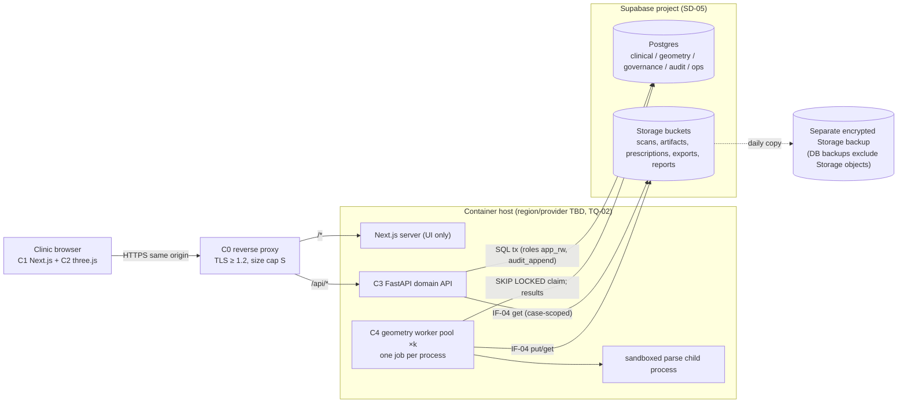

# Technical Design v1.0 — Jude cranial remolding helmet (CRO/CRH) design software

| Field | Value |
|---|---|
| Document | TECHNICAL_DESIGN_v1.0.md |
| Version / date | v1.0 · 2026-11-15 |
| Status | Draft v1.0 for review — engineering proposal. **Not approved**; no decision in this set is final until signed by the engineering lead (ADR/TD status "Proposed"). |
| Stage | Technical Design & Algorithm Selection (follows Functional Specification & System Decomposition v1.0) |
| Owner / approvers | Author: engineering. Approver: engineering lead (A); reviewers: QA lead, product owner, privacy specialist (data architecture), clinical lead (wording only) |
| Boundary | Geometric and software correctness only. Nothing here establishes clinical suitability, fit, safety, effectiveness, regulatory classification or compliance (STK-05, FR-082, SAF-11). No clinical correction rule is defined; all clinical values are technician/clinic inputs (SAF-02, DEC-029). |
| Labels | [P] confirmed by a registered project source; [N] standard literature/library fact not re-read against the primary source in this session; [H] hypothesis requiring a named experiment. Library facts carry a URL and check date 2026-11-15. |

## 0. Summary

- **Coverage:** all 226 catalogue rows (159 functions + 67 subfunctions) have a technical specification (226/226 = 100 %) and an architecture mapping row (226/226).
- **Algorithms:** 61 algorithms catalogued (ALG-01…ALG-61) covering every topic of the brief (mesh processing, solid geometry, cranial geometry, helmet geometry) with principle, sequence, I/O, complexity, numerical limits, edge cases, libraries, alternatives and tests. Out-of-scope topics (denoising, remeshing, reconstruction, shell, wall thickness, symmetry overlay, edge treatment) are described at outline level and marked so.
- **Libraries:** 40 technologies compared with licences verified on 2026-11-15: 11 recommended for the MVP stack, 11 candidates decided by experiments, 3 test oracles, 2 dev tools, 5 reserved for post-MVP, 8 rejected. **No library is approved yet** — ADR-002/ADR-011 and TD-01…TD-26 are Proposed.
- **Architecture:** modular monolith (Next.js UI → same-origin proxy → FastAPI domain API → Postgres job queue → Python geometry worker), now mapped onto the owner-selected **Supabase** platform (Postgres + Storage, SD-05). Supabase database backups do not include Storage objects (Supabase docs, read 2026-11-15) — a separate encrypted Storage backup is a hard requirement (SEC-08, R-41).
- **Geometry kernel:** lean, deterministic, mostly own algorithms on numpy/scipy with exact predicates (own port of the public-domain Shewchuk predicates); one spatial-query library to be chosen by experiment X-01; CGAL, PyMeshLab and trimesh used only as non-shipped oracles. No Boolean is needed for MVP closure (option A).
- **Performance:** no performance number is invented. Approved values used: SD-01/SD-02/SD-03, DEC-025 tolerances, VER-07 determinism. All size/time budgets are TBD with a benchmark methodology (BM-01…07) and experiments (X-01…08).
- **Open items:** 26 technical decisions proposed (0 approved); 26 new technical questions (TQ-01…TQ-26); 7 inherited blocking functional questions; 27 catalogue rows blocked by open decisions (11 functions + 16 subfunctions).
- **Readiness:** **Ready for Implementation Planning with conditions** — see §9.

## 1. Baseline check (performed before design)

### 1.1 Documents, versions and approval status

| Required document | Version used (project path) | Status found | Effect on this design |
|---|---|---|---|
| PRD | claude/v0.2/05P_PRD_v0.2.md | Approved by product owner (DR-2026-11-12 §2 B); header still "Draft"; §4 G4 superseded by DEC-030 | Scope only |
| SRS | claude/v0.2/06_SRS_v0.2.md | Approved by product owner; §5 tables generated from RTM v0.2 — outdated vs RTM v0.3 (GAP-C07, OQ-FS-34) | RTM v0.3 used as requirement master |
| Functional Specification | FUNCTIONAL_SPECIFICATION_v1.0.md (uploaded 2026-11-15; dated 2026-11-12) | Header: "Draft for review — not approved"; no approval record after DR-2026-11-12 found. The brief states the stage is complete → conflict TQ-01 | Used as functional master; TD inherits its draft status |
| Function Catalog | FUNCTION_CATALOG_v1.0.csv (226 rows) | As FS | All rows specified |
| Function–Requirement Traceability | FUNCTION_REQUIREMENT_TRACEABILITY_v1.0.csv | As FS; 200/200 requirements linked | Used |
| Technical Architecture | 07_ARCHITECTURE_AND_DATA_MODEL_v0.1.md + CHANGE_NOTICE_v0.2 (CN-09…15, ADR-015, INV-13…16) | "Draft — not reviewed"; v0.2 architecture changes approved by product owner; ADR-001…014 "Proposed"; no engineering-lead signature (audit N-11); no Supabase mapping (OQ-FS-08) | Container/module identifiers reused; Supabase mapping proposed (TD-13) |
| Requirements Traceability Matrix | 04a_REQUIREMENTS_TRACEABILITY_MATRIX_v0.3.csv (200 rows) | Owner-approved 2026-11-12; not Baselined; row status Proposed 194, Deferred 3, Blocked 2, Unresolved 1; release MVP 174, post-MVP 21, research-only 5 | Requirement master |
| Geometry Validation Plan | claude/v0.2/08_GEOMETRY_VALIDATION_PLAN_v0.2.md | Approved by product owner; header "Draft"; tolerances = DEC-025 option A | Fixtures T1–T12, FM-01…16 reused |
| Software Benchmark | 02_SOFTWARE_BENCHMARK_v0.1.md + 02a/02b CSV | Draft v0.1; not re-issued; informative | Market patterns only |
| Risk Register | claude/v0.2/RISK_REGISTER_v0.2.md + R-40, R-41 (DR §3) | Approved by product owner; ratings preliminary | Risks cited per decision |
| Decision Register | DECISION_RECORD_2026-11-12.md (+ DECISIONS_AND_OPEN_QUESTIONS_V2, v0.2 addendum) | Current; no later record | DEC/SD values used verbatim |
| Algorithm & Technology Assessment (FS companion) | ALGORITHM_TECHNOLOGY_ASSESSMENT_v1.0.md | Draft; experiments X-01…X-05 not run | Superseded in scope by ALGORITHM_CATALOG + LIBRARY_COMPARISON v1.0 (proposals unchanged where not stated) |
| Documentation audit | DOCUMENTATION_AUDIT_v0.3.md | READY WITH CONDITIONS; MA-01, re-audit pending | Conditions inherited |

### 1.2 Identifier consistency (automated check on the uploaded files)

| Check | Result |
|---|---|
| Function IDs unique | 226/226 unique |
| Dependencies resolve to catalogue IDs | 0 dangling references |
| Requirement IDs referenced by the catalogue exist in RTM v0.3 | 200 referenced, 0 unknown, 0 RTM rows unreferenced |
| Functions without own requirement | FN-PMV-11, FN-PMV-12 (outline; no approved requirement — GAP-M05/M06/M15). Subfunctions inherit the parent's requirements (67 rows) |
| Architecture components | All identifiers are 07 identifiers (C0–C6, M01–M13, K01–K09, W01–W08) except the non-07 labels "CI pipeline, deployment" (OPS) and "Future" (PMV). FN-RPT-02 has no rendering component (GAP-M09 → TD-18). C5/C6 assume self-hosted Postgres/filesystem CAS while SD-05 chose Supabase (→ TD-13, OQ-FS-08) |

### 1.3 Conflicts and missing information found in this stage

| ID | Finding | Resolution in this design |
|---|---|---|
| C-TD-01 | FS v1.0 is "Draft for review" but the brief calls the stage complete | Design proceeds as a draft; TQ-01 asks for an approval record |
| C-TD-02 | 07/ADR-002 assumed trimesh as a production kernel dependency (4.x era); trimesh 5.2.1 was released 2026-11-12 (PyPI) | TD-03: trimesh as oracle only |
| C-TD-03 | ATA §A1 listed plyfile licence as "MIT / GPL? — verify"; PyPI metadata: GPL-3.0-or-later | LIB-PLYFILE rejected; own PLY parser (ALG-04) |
| C-TD-04 | 07 ADR-005 assumed filesystem CAS with its own backup; Supabase docs state database backups do not include Storage objects | TD-13 + TQ-03: separate encrypted Storage backup; X-07 |
| C-TD-05 | numpy 2.5.4 and scipy 1.18.1 require Python ≥ 3.12 (PyPI requires_python) | TQ-09: fix Python version and wheel matrix (X-08) |
| C-TD-06 | FN-KVL-05 "Algorithms" field points to ATA §A5 (decimation) instead of §A3 (self-intersection) | Corrected reference in ALG-11; FS errata at next re-issue |
| C-TD-07 | pymeshfix (automatic repair) is AGPL-3.0 per PyPI; automatic repair also contradicts 05 §6.2 | Rejected (LIB-PYMESHFIX) |

Decision taken for the "no unconfirmed assumptions" rule: every element that depends on an unapproved decision is labelled **Proposed** or **Blocked**, linked to its question, and never presented as approved. Blocked functions receive a full technical design so that implementation can start the moment the question is closed, but they are not released for implementation.

## 2. Scope of the technical design

- MVP functions (SS-01…SS-10) are designed to implementation level; outline functions (SS-11, FN-PMV-01…12) receive outline-level designs only.
- Design objects introduced here: algorithms ALG-xx, libraries LIB-xx, data structures DS-xx, interfaces IF-xx, storage zones Z-xx, technical decisions TD-xx, technical questions TQ-xx, performance metrics PM-xx, benchmarks BM-xx, experiments X-xx.
- Not designed here: clinical rules, thresholds, correction magnitudes, landmark sets, base convention values, export frame values, checklist content (clinic configuration, DEC-029); regulatory status (RQ/LQ deferred).

## 3. Architecture

### 3.1 Layers and containers

| Layer (brief) | Containers / packages (07) | Responsibility | Must not |
|---|---|---|---|
| UI Layer | C1 Next.js UI (W01–W08), C2 three.js viewer | Screens, Russian text, gate lists, picking hints, job progress | Compute stored geometry; decide gates; hold secrets |
| Application Layer | C3 FastAPI routers, M12 jobs, idempotency/error middleware, M11 reporting orchestration | Request handling, transactions, job enqueue/completion, OpenAPI contract | Run heavy geometry in request threads |
| Domain Layer | C3 M03–M10 services (case, config, scan, anatomy, measurement, design, review, export) | Business rules, state machines, gate order, versioning | Bypass kernel through jobs; set clinical values |
| Geometry Engine | C4 worker + kernel K01–K09 (pure functions) | All geometry computation, replay, hashing | I/O, DB access, clocks, randomness |
| Data Layer | C5 Supabase Postgres (schemas clinical, geometry, governance, audit, ops), C6 Supabase Storage via IF-04 | Persistence, content-addressed blobs, backups | Overwrite/delete blobs via app credential |
| Import/Export Layer | K01 io, K09 export, M05 intake, M10 export | Untrusted file parsing (sandboxed), STL + manifest hand-off, re-import check | Release unverified files |
| Validation Layer | K02 validate, M09 review, FN-KOP-13 guard, SCN gate | Integrity, validity, gates, post-op guard | Interpret results clinically (FR-082) |
| Security and Audit Layer | M01 identity, M02 audit, permission table, C0 proxy (TLS) | Authn, authz, CSRF, audit chain, read logging | Expose update/delete of audit rows |

### 3.2 Deployment view on Supabase (proposed, TD-13; hosting of C0/C3/C4 open — OQ-FS-08/TQ-02)

### 3.3 Process and thread model (which operations run in separate processes/threads)

| Operation class | Where | Isolation | Reason |
|---|---|---|---|
| Request handling, gates, approval/export transactions | C3 API process (ASGI) | One DB transaction per request; no geometry except hashing helpers | Latency, consistency (ADR-008) |
| Untrusted file parsing (FN-SCN-02, FN-KIO-01…05) | C4 worker → child process | rlimits (CPU time, address space), read-only FS, no network, non-root (SEC-07, TD-16, TQ-20) | Malformed/face-bomb files cannot crash the worker or API |
| Kernel ops: integrity, frame, measurement, regeneration, review, export (FN-K*, FN-DES-03, FN-REV-01, FN-EXP-02) | C4 worker pool | One job per OS process; OMP/BLAS/numba threads = 1; per-job memory limit | Determinism (ADR-010), crash isolation (QAS-04) |
| PDF and deviation-image rendering (FN-RPT-01/02) | C4 worker → child process | Fonts and renderer isolated; time limit | System libraries; memory spikes |
| Scheduled jobs: audit verify, blob re-verify, Storage backup (FN-AUD-03, FN-BLB-03, FN-OPS-05) | C4 worker scheduler (leader via advisory lock, TD-25) | Ordinary jobs | Audited like other jobs |
| Viewer: payload decode, BVH build for picking | Browser Web Worker | Off main thread | UI responsiveness on large LODs |
| Geometry oracle tests (CGAL, PyMeshLab) | Separate CI container | Never shipped (ADR-011) | GPL isolation |

### 3.4 Interfaces (summary — full contracts in DATA_STRUCTURES_AND_INTERFACES_v1.0)

| ID | Interface | Between | Versioning |
|---|---|---|---|
| IF-01 | REST API (browser ↔ C3) | UI Layer → Application Layer | URI major version (/v1); additive changes only within v1; breaking change → /v2 with overlap period |
| IF-02 | Job contract (C3 ↔ C4 via ops.job) | Application Layer ↔ Geometry Engine | job/1 schema; job type names versioned (e.g. regenerate.v1) |
| IF-03 | Kernel operation contract | Geometry Engine (internal) | op_version per op; kernel_version (semver) + container image digest recorded per result |
| IF-04 | BlobStore interface | Data Layer | Interface v1; adapter version recorded in deployment record |
| IF-05 | Display payload jude-mesh/1 | Import/Export → UI Layer | Header version field |
| IF-06 | Export hand-off | Import/Export → production (outside Jude) | jude-manifest/0.1 schema id |
| IF-07 | Configuration schema | Domain ↔ Data | Schema version in document; migration functions for config/1 → config/2 |
| IF-08 | Audit append (internal) | Security and Audit (used by all) | audit/1 |
| IF-09 | Permission table | Security and Audit | Versioned with code; schema checked at start-up |
| IF-10 | Report renderer | Application (worker) | Template version recorded in report record |
| IF-11 | Scan import (file intake) | UI → Import/Export | — |
| IF-12 | CI oracle interface | Build/CI | Fixture set version |

## 4. Technology stack recommendation (summary of LIBRARY_COMPARISON_v1.0)

| Concern | Recommended (status) | Candidates decided by experiment | Oracles / dev only | Rejected (reason) |
|---|---|---|---|---|
| Language/runtime | Python 3.12/3.13 (TQ-09); TypeScript/Next.js (DEC-010) | C++ extension only if X-06 fails | — | — |
| Numerics | numpy 2.5.4, scipy 1.18.1 (R-MVP) | numba 0.68.1 (X-06) | — | — |
| Mesh I/O | Own parsers (ALG-01…05) | numpy-stl (second reader for FR-102) | trimesh 5.2.1 | plyfile (GPL-3.0+) |
| Topology/validation | Own (ALG-07…13) | — | CGAL PMP, trimesh | pymeshfix (AGPL, silent repair) |
| Exact predicates | Own port of Shewchuk (public domain) | — | Python fractions | — |
| Spatial queries (closest point, rays) | — | libigl 2.6.3 (MPL-2.0) / Open3D 0.20.0 (MIT) / own numba BVH (X-01) | trimesh proximity | — |
| Decimation / LOD | — | fast-simplification 0.2.0, meshoptimizer, VTK 9.7.2 (X-01) | — | — |
| Smoothing | — | VTK windowed sinc vs own (TQ-06) | — | — |
| Booleans / SDF shell | — | — | manifold3d 3.5.5 (RESERVE) | MeshLib (commercial), CGAL (GPL) |
| Cap triangulation | Own exact ear clipping (TD-12) | mapbox-earcut 2.1.0 (ISC) as oracle | — | Shewchuk Triangle (non-free commercial) |
| CAD/B-Rep, FE meshing, volumetric | — | — | — | OCCT, Gmsh (GPL), ITK (no CT input) |
| Desktop UI | — | — | — | Qt/PySide6/PyQt6 (web app decided, DEC-010) |
| Viewer | three.js 0.187.0 + three-mesh-bvh 0.9.18 | vtk.js 38.0.9 (fallback) | — | — |
| API / DB / storage | FastAPI 0.163.1, Postgres + Storage on Supabase (SD-05) | — | — | — |
| PDF | WeasyPrint 70.0 + own rasteriser (TD-18) | VTK off-screen | — | — |
| Tests | pytest, hypothesis, Playwright, vitest (DEV) | — | CGAL, PyMeshLab, trimesh | — |

Rationale in one line: a lean, licence-clean, deterministic kernel whose every design-path operation is specified here and tested against independent oracles is easier to verify (VER-07/VER-08) than a stack of large libraries whose behaviour changes between releases (R-29).

## 5. System architecture mapping (summary of FUNCTION_COMPONENT_MAPPING_v1.0.csv)

| Primary layer | Catalogue rows |
|---|---|
| Domain Layer | 82 |
| Geometry Engine | 56 |
| Application Layer | 24 |
| Validation Layer | 20 |
| Security and Audit Layer | 18 |
| Import/Export Layer | 16 |
| UI Layer | 6 |
| Data Layer | 4 |

| Module | Primary layer | Runtime | Interfaces | Versioning |
|---|---|---|---|---|
| IAM | Security and Audit Layer | C3 API process (request thread); C1 browser for screens | IF-01; IF-08; IF-09 | Permission table version; session schema migration |
| API | Application Layer | C3 API process | IF-01 | /api/v1 (TD-22); error catalogue version error/1 |
| AUD | Security and Audit Layer | C3 API process (append in caller transaction); C4 worker (verify job) | IF-08 | audit/1 event schema; event type list versioned |
| CFG | Domain Layer | C3 API process; C1 admin screens; C4 for safety check job | IF-01; IF-07 | config/1 schema; migration functions for schema changes |
| JOB | Application Layer | C3 (enqueue, status, completion handler) + C4 worker pool (claim/run) | IF-02 | job/1 payload schema; job type names with version suffix |
| BLB | Data Layer | C3/C4 via IF-04; scheduled verification in C4 | IF-04 | Blob key layout v1 (<bucket>/<sha[0:2]>/<sha>) |
| CAS | Domain Layer | C3 API; C1 screens (W02, W07) | IF-01; IF-04; IF-08 | DB migrations (Alembic, forward-only) |
| SCN | Domain Layer | C3 API (gates, records); C4 worker (parse, integrity, gate jobs) with sandboxed parse subprocess | IF-01; IF-02; IF-03; IF-04; IF-11 | integrity/1, gate result schema |
| KIO | Import/Export Layer | C4 worker process (pure function, single-threaded numerics); never in C3 request threads except hashing helpers | IF-03 | op_version per op; kernel_version + image digest per result |
| KVL | Validation Layer | C4 worker process (pure function, single-threaded numerics); never in C3 request threads except hashing helpers | IF-03 | op_version per op; kernel_version + image digest per result |
| KFR | Geometry Engine | C4 worker process (pure function, single-threaded numerics); never in C3 request threads except hashing helpers | IF-03 | op_version per op; kernel_version + image digest per result |
| KAN | Geometry Engine | C4 worker process (pure function, single-threaded numerics); never in C3 request threads except hashing helpers | IF-03 | op_version per op; kernel_version + image digest per result |
| KMS | Geometry Engine | C4 worker process (pure function, single-threaded numerics); never in C3 request threads except hashing helpers | IF-03 | op_version per op; kernel_version + image digest per result |
| KOP | Geometry Engine | C4 worker process (pure function, single-threaded numerics); never in C3 request threads except hashing helpers | IF-03 | op_version per op; kernel_version + image digest per result |
| KCP | Geometry Engine | C4 worker process (pure function, single-threaded numerics); never in C3 request threads except hashing helpers | IF-03 | op_version per op; kernel_version + image digest per result |
| KRP | Geometry Engine | C4 worker process (pure function, single-threaded numerics); never in C3 request threads except hashing helpers | IF-03 | op_version per op; kernel_version + image digest per result |
| KEX | Import/Export Layer | C4 worker process (pure function, single-threaded numerics); never in C3 request threads except hashing helpers | IF-03 | op_version per op; kernel_version + image digest per result |
| ANA | Domain Layer | C3 API; C4 jobs (snap, frame, coverage); C1 W03 screens | IF-01; IF-02; IF-03 | Frame definition version; landmark history append-only |
| MEA | Domain Layer | C3 API; C4 measurement job; C1 W04 | IF-01; IF-02; IF-03 | Definition id+version stored per value |
| DES | Domain Layer | C3 API; C4 regenerate job; C1 W05 workspace | IF-01; IF-02; IF-03; IF-05 | op_version; DesignVersion.kernel_version + image digest |
| REV | Validation Layer | C3 API (gates, approval transaction); C4 review job; C1 W06 | IF-01; IF-02; IF-03 | DATA-05 schema; checklist version |
| EXP | Import/Export Layer | C3 API (gates); C4 export job | IF-01; IF-02; IF-06 | jude-manifest/0.1; STL header schema id |
| RPT | Application Layer | C4 worker (render in child process); C3 download | IF-10; IF-04 | Template version stored per report |
| UIX | UI Layer | C1/C2 browser (main thread + Web Worker for payload decode and BVH) | IF-01; IF-05 | Generated OpenAPI client version pinned to API |
| OPS | Application Layer | CI runners; operator procedures; oracle container (GPL tools, never shipped) | IF-12 | Fixture set version; SOUP list per release |
| PMV | Domain Layer | Future (outline) | — | — |

### 5.1 Error-handling policies referenced by the function specifications

| Policy | Applies to | Rule |
|---|---|---|
| EH-KRN | Kernel operation (pure function) | Kernel contract: precondition/validity violations → OpResult status "rejected" with reason code and no output geometry; unexpected exceptions → status "failed" (job marked failed, last valid geometry kept, SAF-09); never partial outputs. |
| EH-JOB | Background job | Job contract: deterministic kernel rejections → job failed with code (no retry); infrastructure errors → retry while attempts < 3 and job idempotent; completion handler commits result + domain change + audit atomically or not at all. |
| EH-API | User interaction / API service (synchronous) | Not specified (outline). |
| EH-CI | Build / CI tooling | CI stage fails the pipeline with a machine-readable report; no partial artefact is published. |
| EH-PROC | Operational procedure (software-supported) | Procedure halts on any failed step; each step leaves an audit/record entry; re-run is idempotent where stated. |
| EH-OUT | Outline (post-MVP / research-only) | Not specified (outline). |

Error handling across layers: kernel returns `rejected|failed` (never partial geometry) → job layer maps to job status/error code → completion handler commits atomically → API returns DS-24 gate lists → UI renders next required step (FN-UIX-03). Versioning: `/api/v1`, `op_version` per op, `kernel_version` + image digest per result, schema ids (jude-arr/1, jude-mesh/1, jude-manifest/0.1, config/1, audit/1, job/1).

## 6. Data architecture (summary)

Five storage zones separate clinical metadata from geometry (DATA_STRUCTURES_AND_INTERFACES_v1.0 §3):

| Zone | Content | Buckets | Access |
|---|---|---|---|
| Z-CLIN Clinical metadata zone | clinical.case, clinical.consent_ref, clinical.prescription, clinical.scan_metadata, clinical.cohort (conditional) | Bucket "prescriptions" (directly identifying file, R-40) | Technician + clinic admin per permission table; every read logged (SEC-15); downloads controlled (SEC-16) |
| Z-GEO Geometry zone (pseudonymised personal health data, DEC-019) | geometry.scan, geometry.landmark*, geometry.frame, geometry.measurement_*, geometry.design*, geometry.operation, geometry.validity_report, data.artifact | Buckets "scans" (originals), "artifacts" (derived arrays, LOD, fields) | Case-scoped reads via API only; SHAs are not capabilities (FR-002) |
| Z-GOV Governance and records zone | governance.user, session, role_grant, config_version, measurement_definition, frame_definition, approval, rejection, export, report, template* | Buckets "exports", "reports" | Role-restricted; approvals/exports technician-only (FR-130) |
| Z-AUD Audit zone | audit.audit_event (core, hashed), audit.audit_summary (erasable), audit.chain_head | — | INSERT-only role for app; SELECT for admin views; no UPDATE/DELETE grants |
| Z-OPS Operations zone | ops.job, ops.idempotency_key, ops.backup_record, ops.blob_verification | — | Service roles (api, worker) |

The only directly identifying object is the attached prescription file (R-40); it lives in its own bucket, is never parsed, and every view/download is logged (SEC-15/16).

## 7. Performance and scalability (summary)

See PERFORMANCE_REQUIREMENTS_v1.0. Approved numeric values: SD-01 lockout, SD-02 idle 30 min, SD-03 RPO/RTO 24 h, DEC-025 tolerances, VER-07 determinism. All mesh-size, time and memory budgets are **TBD** and will be proposed from BM-01 (synthetic, allowed now) and BM-02 (real scans, only after VER-22).

## 8. Testing (summary)

See GEOMETRY_TESTING_STRATEGY_v1.0. Four separated levels: software correctness (L0), geometric validity (L1), manufacturing validation (L2, recorded by production), clinical validation (L3/L4 — outside this software; passing geometric tests is not evidence of clinical safety).

## 9. Quality gate and readiness

| Gate item | Evidence | Result |
|---|---|---|
| All Function IDs covered | 226/226 specified; 226/226 mapped | PASS |
| All functions linked to requirements | 157 functions with own requirements; 67 subfunctions inherit; 2 outline functions without requirement (FN-PMV-11, FN-PMV-12) — registered gaps | PASS with registered gaps |
| Algorithms technically described | 61 ALG entries with all 9 required aspects (9 outline entries for out-of-scope topics state that tests are designed when scoped); every kernel function maps to ≥ 1 ALG | PASS |
| Library choices justified | 40 entries with recommendation + rationale | PASS |
| Licences checked | Version/licence/date/source recorded for all 40 entries (2026-11-15); legal review pending (TQ-24) | PASS (engineering check only) |
| Interfaces defined | 12 interfaces, 25 data structures; every mapping row names interfaces | PASS |
| Testing defined | Per-ALG unit/synthetic/edge/regression/numerical/invariant/performance tests; per-function unit + integration requirements | PASS |
| Open questions registered | 26 TQ + 7 inherited blocking OQ-FS + 8 experiments | PASS |
| No unconfirmed decision presented as approved | All TD = Proposed; libraries labelled R-MVP/CAND (none "selected") | PASS |
| No program code written | Documents contain contracts, formulas and pseudosteps only | PASS |

### 9.1 Blocking questions

| ID | Blocks | Owner |
|---|---|---|
| OQ-FS-01 closure position | FN-KOP-06, FN-KRP-01, FN-DES-01/02 | Engineering lead + clinic technician |
| OQ-FS-02 formula representation | FN-CFG-05, FN-MEA-01 | Engineering lead + product owner |
| OQ-FS-03 contour/diagonal rules (+TQ-18) | FN-KMS-02, FN-KMS-04, FN-MEA-01 | Product owner + clinic technician |
| OQ-FS-04 measurement set bound at approval | FN-REV-04 | Product owner |
| OQ-FS-06 error-code catalogue freeze | FN-API-02 (API contract) | Engineering lead |
| OQ-FS-07 erasure vs immutable storage/audit | FN-BLB-04, FN-CAS-08, FN-AUD-01 | Engineering lead + privacy specialist |
| OQ-FS-08 Supabase mapping (+TQ-02, TQ-03, TQ-20) | Deployment, real data, FN-BLB-*, FN-OPS-05 | Engineering lead |

### 9.2 Recommendation

**Ready for Implementation Planning — with conditions.** Implementation planning can start now for dependency layers 0–5 of the FS (platform services, kernel I/O, validation, frames, hashing, replay) and for all functions in status Ready, using synthetic data only. Conditions before the affected work is *implemented*: (1) record approval of FS v1.0 and of this TD set (TQ-01); (2) close OQ-FS-06 before freezing the API contract; (3) close OQ-FS-08 with TQ-02/03/20 and run X-07 before any real data; (4) close OQ-FS-02/03 before measurement, OQ-FS-01 before closure, OQ-FS-04 before approval; (5) run X-01, X-02, X-06 and X-08 before library lock-in (engineering-lead sign-off of TD-02/03/05/11). Performance budgets remain TBD until BM-01/BM-02.

## 10. Deliverable index

| # | File | Content |
|---|---|---|
| 1 | TECHNICAL_DESIGN_v1.0.md | This document |
| 2 | FUNCTION_TECHNICAL_SPECIFICATIONS_v1.0.md | 22-field technical specification for all 226 catalogue rows |
| 3 | CAD_GEOMETRY_ENGINE_DESIGN_v1.0.md | Kernel architecture and all algorithms by brief topic |
| 4 | ALGORITHM_CATALOG_v1.0.csv | 61 algorithms, 25 columns |
| 5 | LIBRARY_COMPARISON_v1.0.csv | 40 technologies with licence/version/date/source |
| 6 | FUNCTION_COMPONENT_MAPPING_v1.0.csv | Function → layer, container, process/thread, interfaces, contracts, zone, ALG, LIB, TD, error codes |
| 7 | DATA_STRUCTURES_AND_INTERFACES_v1.0.md | DS-01…25, IF-01…12, storage zones, schemas, access, retention, versioning |
| 8 | GEOMETRY_TESTING_STRATEGY_v1.0.md | Test levels, fixtures, oracles, per-algorithm test design |
| 9 | PERFORMANCE_REQUIREMENTS_v1.0.md | PM-01…20, complexity, memory model, BM-01…07, X-01…08 |
| 10 | TECHNICAL_DECISIONS_v1.0.md | TD-01…26 (all Proposed) + ADR status |
| 11 | TECHNICAL_OPEN_QUESTIONS_v1.0.md | TQ-01…26 + inherited OQ-FS + experiments |
